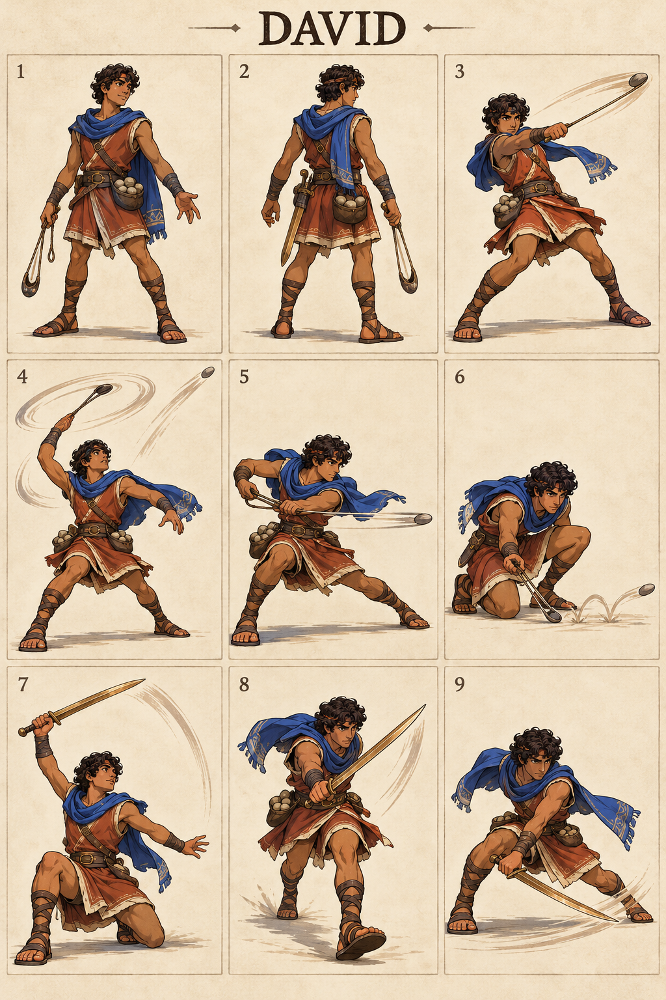

# David — The Shepherd Champion

## Character build prompt

Implement David as a complete playable Covenant Clash fighter. Use the master, shared physics, weapon kits and this signature specification. Finish moves and animations as independent clips; do not turn the reference sheet into a nine-frame attack. No attack is a documented biblical action unless expressly noted as context.

## Bible background

**References:** 1 Samuel 17:34–51; 2 Samuel 5:1–5. A shepherd who trusted the Lord when facing Goliath; later king of Israel. His trust is a story theme, not a combat power meter. The arena moves below are invented for this fictional sporting game. Story context is optional and separate from controls. No victory/defeat measures spiritual worth.

## Identity and visual lock

Young adult, warm brown skin, curly dark hair, short russet tunic, cobalt shoulder scarf, tan leather wraps, five-stone pouch, slender bronze sword and woven sling; no crown in this shepherd design.

**Neutral posture:** Relaxed angled stance, sling hanging from right hand, left palm open; quick footwork and modest expression.

**Stats:** Power 4, Guard 4, Speed 7; total 15. Common capsule 40×74 units. Stats alter damage/knockback/run cap only, never frame timing. **Weakness:** Short melee reach and light survivability; sling lanes can be jumped.

## Generated sheet

Read panels left-to-right, top-to-bottom. They are illustrative key poses, not final runtime frames.

| Panel | Meaning |
|---|---|
| 1 | Front/idle identity |
| 2 | Back/turnaround |
| 3 | Example ordinary Light attack; family file supplies full kit |
| 4 | Sling N: Skyward Stone |
| 5 | Sling S: Valley Line |
| 6 | Sling D: Shepherd Skip |
| 7 | Sword N: Rising Courage |
| 8 | Sword S: Forward Resolve |
| 9 | Sword D: Guarded Sweep |

## Complete shared attacks

- [Sling full kit](../../02_Gameplay/Weapons/sling_complete_kit.md): nlight, slight, dlight, nair, sair, dair, recovery and ground pound.
- [Sword full kit](../../02_Gameplay/Weapons/sword_complete_kit.md): nlight, slight, dlight, nair, sair, dair, recovery and ground pound.
- [Unarmed complete kit](../../02_Gameplay/Weapons/unarmed_complete_kit.md): eight basics plus three grounded heavies.

Weapon A/B alternate on neutral pickup. Ordinary weapon lights/aerials use their family rules. The fighter-specific signatures below replace grounded weapon Heavy. All attack controls are semantic, so N/S/D mean neutral/side/down direction with Heavy on any selected input device.

## Six signatures

S/A/R = startup/active/recovery ticks at 60 Hz, before optional charge hold. Base damage precedes Power scaling. One hit per target per instance.

| Art panel | Weapon | Input | Signature | S/A/R | Damage | Role |
|---|---|---|---|---|---|---|
| 4 | Sling | N+Heavy | Skyward Stone | 18/5/24 | 23 | anti-air |
| 5 | Sling | S+Heavy | Valley Line | 22/6/28 | 26 | ranged punish |
| 6 | Sling | D+Heavy | Shepherd Skip | 24/6/30 | 24 | low lane control |
| 7 | Sword | N+Heavy | Rising Courage | 17/5/24 | 24 | close anti-air |
| 8 | Sword | S+Heavy | Forward Resolve | 21/5/29 | 27 | commitment finisher |
| 9 | Sword | D+Heavy | Guarded Sweep | 23/6/30 | 25 | ground punish |

### 1. Skyward Stone — sling N

**What it looks like:** David plants his back foot, makes one compact overhead sling circle, and releases a stone diagonally upward; scarf follows the spin.

**Timeline:** ticks 0–17 prepare; 18–22 active; 23–46 recover. Hold grounded Heavy extends the anticipation by at most 36 ticks, with no free invulnerability. Aerial use needs the valid neutral-dodge cancel; ordinary airborne Heavy remains the family recovery/ground-pound.

**Simulation:** base damage 23, hitstun 22 ticks, base force 1280 Q/tick, growth 10 Q per whole damage unit, launch 67° with facing mirror. No scripted body translation; the attack reaches through the prop/limb animation only. Release one 14×14-unit projectile at local origin [28, 68], speed 14 units/tick and 60-tick lifetime, travel angle 67°; paint trails without creating extra hitboxes.

**Purpose and counterplay:** Anti-Air. Jump or dodge the finite projectile lane, then approach during the recovery. There is no homing or reflection. Whiff recovery is paid in full; no signature chain-cancel. Test opponents at low/high damage, edge spacing, mirrored facing and near a platform side.

**Animator instruction:** show one readable anticipation, one distinct contact silhouette and one vulnerable finish. Keep face, costume and foot pivot consistent with panels 1–2. Panel 4 illustrates the intended contact, not the whole animation or an exact trajectory.

### 2. Valley Line — sling S

**What it looks like:** David leans into a low side step, rotates his sling at waist height, and fires one clean horizontal stone; shoulders visibly recoil.

**Timeline:** ticks 0–21 prepare; 22–27 active; 28–55 recover. Hold grounded Heavy extends the anticipation by at most 36 ticks, with no free invulnerability. Aerial use needs the valid neutral-dodge cancel; ordinary airborne Heavy remains the family recovery/ground-pound.

**Simulation:** base damage 26, hitstun 22 ticks, base force 1280 Q/tick, growth 10 Q per whole damage unit, launch 22° with facing mirror. No scripted body translation; the attack reaches through the prop/limb animation only. Release one 14×14-unit projectile at local origin [28, 45], speed 14 units/tick and 60-tick lifetime, travel angle 0°; paint trails without creating extra hitboxes.

**Purpose and counterplay:** Ranged Punish. Jump or dodge the finite projectile lane, then approach during the recovery. There is no homing or reflection. Whiff recovery is paid in full; no signature chain-cancel. Test opponents at low/high damage, edge spacing, mirrored facing and near a platform side.

**Animator instruction:** show one readable anticipation, one distinct contact silhouette and one vulnerable finish. Keep face, costume and foot pivot consistent with panels 1–2. Panel 5 illustrates the intended contact, not the whole animation or an exact trajectory.

### 3. Shepherd Skip — sling D

**What it looks like:** David drops into a crouch and sends a single skipping stone through a short low lane; he remains at the start position.

**Timeline:** ticks 0–23 prepare; 24–29 active; 30–59 recover. Hold grounded Heavy extends the anticipation by at most 36 ticks, with no free invulnerability. Aerial use needs the valid neutral-dodge cancel; ordinary airborne Heavy remains the family recovery/ground-pound.

**Simulation:** base damage 24, hitstun 22 ticks, base force 1280 Q/tick, growth 10 Q per whole damage unit, launch 22° with facing mirror. No scripted body translation; the attack reaches through the prop/limb animation only. Release one 14×14-unit projectile at local origin [28, 12], speed 14 units/tick and 60-tick lifetime, travel angle 0°; paint trails without creating extra hitboxes.

**Purpose and counterplay:** Low Lane Control. Jump or dodge the finite projectile lane, then approach during the recovery. There is no homing or reflection. Whiff recovery is paid in full; no signature chain-cancel. Test opponents at low/high damage, edge spacing, mirrored facing and near a platform side.

**Animator instruction:** show one readable anticipation, one distinct contact silhouette and one vulnerable finish. Keep face, costume and foot pivot consistent with panels 1–2. Panel 6 illustrates the intended contact, not the whole animation or an exact trajectory.

### 4. Rising Courage — sword N

**What it looks like:** David kneels slightly, then draws a narrow rising sword arc above his head; his off hand balances behind.

**Timeline:** ticks 0–16 prepare; 17–21 active; 22–45 recover. Hold grounded Heavy extends the anticipation by at most 36 ticks, with no free invulnerability. Aerial use needs the valid neutral-dodge cancel; ordinary airborne Heavy remains the family recovery/ground-pound.

**Simulation:** base damage 24, hitstun 22 ticks, base force 1280 Q/tick, growth 10 Q per whole damage unit, launch 90° with facing mirror. No scripted body translation; the attack reaches through the prop/limb animation only. Initial local contact rectangle: [-18, 40, 35, 120] design units; refine the prototype envelope against final animation.

**Purpose and counterplay:** Close Anti-Air. Leave the contact region before active frames, then punish the exposed ending pose. No armor protects this move. Whiff recovery is paid in full; no signature chain-cancel. Test opponents at low/high damage, edge spacing, mirrored facing and near a platform side.

**Animator instruction:** show one readable anticipation, one distinct contact silhouette and one vulnerable finish. Keep face, costume and foot pivot consistent with panels 1–2. Panel 7 illustrates the intended contact, not the whole animation or an exact trajectory.

### 5. Forward Resolve — sword S

**What it looks like:** David takes two quick steps and makes one diagonal front slash; his leading knee bends and the scarf points backward.

**Timeline:** ticks 0–20 prepare; 21–25 active; 26–54 recover. Hold grounded Heavy extends the anticipation by at most 36 ticks, with no free invulnerability. Aerial use needs the valid neutral-dodge cancel; ordinary airborne Heavy remains the family recovery/ground-pound.

**Simulation:** base damage 27, hitstun 22 ticks, base force 1280 Q/tick, growth 10 Q per whole damage unit, launch 22° with facing mirror. The fighter advances 6 design units per active tick, stopped by solid collision. Initial local contact rectangle: [24, 24, 110, 55] design units; refine the prototype envelope against final animation.

**Purpose and counterplay:** Commitment Finisher. Leave the contact region before active frames, then punish the exposed ending pose. No armor protects this move. Whiff recovery is paid in full; no signature chain-cancel. Test opponents at low/high damage, edge spacing, mirrored facing and near a platform side.

**Animator instruction:** show one readable anticipation, one distinct contact silhouette and one vulnerable finish. Keep face, costume and foot pivot consistent with panels 1–2. Panel 8 illustrates the intended contact, not the whole animation or an exact trajectory.

### 6. Guarded Sweep — sword D

**What it looks like:** David shifts weight onto his rear heel and sweeps the blade just above the floor in front, finishing with both feet grounded.

**Timeline:** ticks 0–22 prepare; 23–28 active; 29–58 recover. Hold grounded Heavy extends the anticipation by at most 36 ticks, with no free invulnerability. Aerial use needs the valid neutral-dodge cancel; ordinary airborne Heavy remains the family recovery/ground-pound.

**Simulation:** base damage 25, hitstun 22 ticks, base force 1280 Q/tick, growth 10 Q per whole damage unit, launch 22° with facing mirror. No scripted body translation; the attack reaches through the prop/limb animation only. Initial local contact rectangle: [20, 0, 105, 20] design units; refine the prototype envelope against final animation.

**Purpose and counterplay:** Ground Punish. Leave the contact region before active frames, then punish the exposed ending pose. No armor protects this move. Whiff recovery is paid in full; no signature chain-cancel. Test opponents at low/high damage, edge spacing, mirrored facing and near a platform side.

**Animator instruction:** show one readable anticipation, one distinct contact silhouette and one vulnerable finish. Keep face, costume and foot pivot consistent with panels 1–2. Panel 9 illustrates the intended contact, not the whole animation or an exact trajectory.

## Gameplay personality

Use the strengths shown by the weapon pairing while preserving the stated weakness. Start practice with movement and family lights; use signatures as deliberate reads or punishers. Recovery and dodging use the exact shared resource rules. No character-exclusive miracle, invulnerability, teammate buff or hidden auto-aim. Cosmetics must keep the weapon and player marker readable.

## Required character output and verification

Portrait, selection icon, model/turnaround, weapon A/B/unarmed locomotion, defense/item animations, all family attacks and six signature timelines, atlas/rig metadata, valid attack IDs and replay tests. Check both facing directions, every input method, idle-to-attack transition, getting hit mid-charge, weapon throw/pickup and ring-out/respawn. Review face, hands, grip, costume continuity, pivot and tiny-screen silhouette. Final asset readiness must be recorded; the supplied PNG is concept art.

## ELI5

David has two sets of tools. Pick up a tool, then use direction plus Light or Heavy. Big moves hit harder but leave a longer opening if you miss. Good timing beats button spam.
