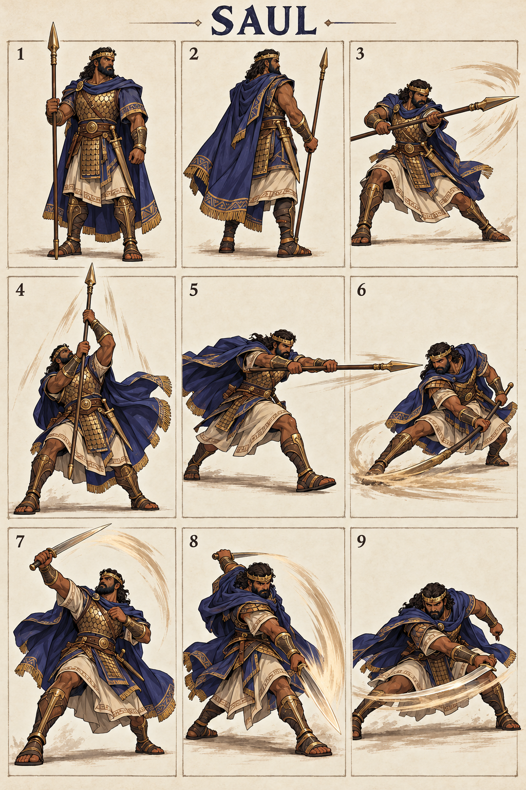

# Saul — The First King

## Character build prompt

Implement Saul as a complete playable Covenant Clash fighter. Use the master, shared physics, weapon kits and this signature specification. Finish moves and animations as independent clips; do not turn the reference sheet into a nine-frame attack. No attack is a documented biblical action unless expressly noted as context.

## Bible background

**References:** 1 Samuel 9:1–2; 10:24; 18:10–11; 31:1–6. Israel’s first king, notably tall. His failures are not rewritten as righteousness; competitive inclusion is not moral endorsement. The arena moves below are invented for this fictional sporting game. Story context is optional and separate from controls. No victory/defeat measures spiritual worth.

## Identity and visual lock

Tall mature man, medium-deep brown complexion, thick dark beard, indigo royal cloak, restrained brass circlet, layered bronze scale armor, long spear and straight sword; heavy angular silhouette.

**Neutral posture:** Upright guarded stance, spear vertical, shoulders square; authority mixed with tension, no demonic possession effects.

**Stats:** Power 6, Guard 6, Speed 3; total 15. Common capsule 40×74 units. Stats alter damage/knockback/run cap only, never frame timing. **Weakness:** Slow movement and long signature recovery; opponents can bait his reach.

## Generated sheet

Read panels left-to-right, top-to-bottom. They are illustrative key poses, not final runtime frames.

| Panel | Meaning |
|---|---|
| 1 | Front/idle identity |
| 2 | Back/turnaround |
| 3 | Example ordinary Light attack; family file supplies full kit |
| 4 | Spear N: Royal Reach |
| 5 | Spear S: King’s Advance |
| 6 | Spear D: Border Sweep |
| 7 | Sword N: Crown Guard |
| 8 | Sword S: Royal Cleave |
| 9 | Sword D: Low Command |

## Complete shared attacks

- [Spear full kit](../../02_Gameplay/Weapons/spear_complete_kit.md): nlight, slight, dlight, nair, sair, dair, recovery and ground pound.
- [Sword full kit](../../02_Gameplay/Weapons/sword_complete_kit.md): nlight, slight, dlight, nair, sair, dair, recovery and ground pound.
- [Unarmed complete kit](../../02_Gameplay/Weapons/unarmed_complete_kit.md): eight basics plus three grounded heavies.

Weapon A/B alternate on neutral pickup. Ordinary weapon lights/aerials use their family rules. The fighter-specific signatures below replace grounded weapon Heavy. All attack controls are semantic, so N/S/D mean neutral/side/down direction with Heavy on any selected input device.

## Six signatures

S/A/R = startup/active/recovery ticks at 60 Hz, before optional charge hold. Base damage precedes Power scaling. One hit per target per instance.

| Art panel | Weapon | Input | Signature | S/A/R | Damage | Role |
|---|---|---|---|---|---|---|
| 4 | Spear | N+Heavy | Royal Reach | 22/5/31 | 27 | high anti-air |
| 5 | Spear | S+Heavy | King’s Advance | 25/5/34 | 29 | long lane finisher |
| 6 | Spear | D+Heavy | Border Sweep | 26/7/35 | 27 | ground control |
| 7 | Sword | N+Heavy | Crown Guard | 21/6/31 | 27 | anti-air punish |
| 8 | Sword | S+Heavy | Royal Cleave | 25/6/35 | 30 | whiff punish |
| 9 | Sword | D+Heavy | Low Command | 27/6/36 | 28 | low finisher |

### 1. Royal Reach — spear N

**What it looks like:** Saul braces his spear with both hands and drives its tip upward in a single near-vertical thrust; cloak spreads behind him.

**Timeline:** ticks 0–21 prepare; 22–26 active; 27–57 recover. Hold grounded Heavy extends the anticipation by at most 36 ticks, with no free invulnerability. Aerial use needs the valid neutral-dodge cancel; ordinary airborne Heavy remains the family recovery/ground-pound.

**Simulation:** base damage 27, hitstun 22 ticks, base force 1280 Q/tick, growth 10 Q per whole damage unit, launch 90° with facing mirror. No scripted body translation; the attack reaches through the prop/limb animation only. Initial local contact rectangle: [10, 40, 30, 155] design units; refine the prototype envelope against final animation.

**Purpose and counterplay:** High Anti-Air. Leave the contact region before active frames, then punish the exposed ending pose. No armor protects this move. Whiff recovery is paid in full; no signature chain-cancel. Test opponents at low/high damage, edge spacing, mirrored facing and near a platform side.

**Animator instruction:** show one readable anticipation, one distinct contact silhouette and one vulnerable finish. Keep face, costume and foot pivot consistent with panels 1–2. Panel 4 illustrates the intended contact, not the whole animation or an exact trajectory.

### 2. King’s Advance — spear S

**What it looks like:** Saul strides forward and thrusts once at chest height, leaning behind a long spear silhouette.

**Timeline:** ticks 0–24 prepare; 25–29 active; 30–63 recover. Hold grounded Heavy extends the anticipation by at most 36 ticks, with no free invulnerability. Aerial use needs the valid neutral-dodge cancel; ordinary airborne Heavy remains the family recovery/ground-pound.

**Simulation:** base damage 29, hitstun 22 ticks, base force 1280 Q/tick, growth 10 Q per whole damage unit, launch 22° with facing mirror. The fighter advances 6 design units per active tick, stopped by solid collision. Initial local contact rectangle: [24, 24, 165, 55] design units; refine the prototype envelope against final animation.

**Purpose and counterplay:** Long Lane Finisher. Leave the contact region before active frames, then punish the exposed ending pose. No armor protects this move. Whiff recovery is paid in full; no signature chain-cancel. Test opponents at low/high damage, edge spacing, mirrored facing and near a platform side.

**Animator instruction:** show one readable anticipation, one distinct contact silhouette and one vulnerable finish. Keep face, costume and foot pivot consistent with panels 1–2. Panel 5 illustrates the intended contact, not the whole animation or an exact trajectory.

### 3. Border Sweep — spear D

**What it looks like:** Saul bends low and sweeps the spear shaft across the floor in front, with a clearly visible low ending pose.

**Timeline:** ticks 0–25 prepare; 26–32 active; 33–67 recover. Hold grounded Heavy extends the anticipation by at most 36 ticks, with no free invulnerability. Aerial use needs the valid neutral-dodge cancel; ordinary airborne Heavy remains the family recovery/ground-pound.

**Simulation:** base damage 27, hitstun 22 ticks, base force 1280 Q/tick, growth 10 Q per whole damage unit, launch 22° with facing mirror. No scripted body translation; the attack reaches through the prop/limb animation only. Initial local contact rectangle: [20, 0, 155, 18] design units; refine the prototype envelope against final animation.

**Purpose and counterplay:** Ground Control. Leave the contact region before active frames, then punish the exposed ending pose. No armor protects this move. Whiff recovery is paid in full; no signature chain-cancel. Test opponents at low/high damage, edge spacing, mirrored facing and near a platform side.

**Animator instruction:** show one readable anticipation, one distinct contact silhouette and one vulnerable finish. Keep face, costume and foot pivot consistent with panels 1–2. Panel 6 illustrates the intended contact, not the whole animation or an exact trajectory.

### 4. Crown Guard — sword N

**What it looks like:** Saul raises the sword from a guarded chest position into a broad upward arc, leaving his sides exposed.

**Timeline:** ticks 0–20 prepare; 21–26 active; 27–57 recover. Hold grounded Heavy extends the anticipation by at most 36 ticks, with no free invulnerability. Aerial use needs the valid neutral-dodge cancel; ordinary airborne Heavy remains the family recovery/ground-pound.

**Simulation:** base damage 27, hitstun 22 ticks, base force 1280 Q/tick, growth 10 Q per whole damage unit, launch 67° with facing mirror. No scripted body translation; the attack reaches through the prop/limb animation only. Initial local contact rectangle: [-33, 40, 65, 135] design units; refine the prototype envelope against final animation.

**Purpose and counterplay:** Anti-Air Punish. Leave the contact region before active frames, then punish the exposed ending pose. No armor protects this move. Whiff recovery is paid in full; no signature chain-cancel. Test opponents at low/high damage, edge spacing, mirrored facing and near a platform side.

**Animator instruction:** show one readable anticipation, one distinct contact silhouette and one vulnerable finish. Keep face, costume and foot pivot consistent with panels 1–2. Panel 7 illustrates the intended contact, not the whole animation or an exact trajectory.

### 5. Royal Cleave — sword S

**What it looks like:** Saul winds his sword behind one shoulder and releases a heavy diagonal cleave in front.

**Timeline:** ticks 0–24 prepare; 25–30 active; 31–65 recover. Hold grounded Heavy extends the anticipation by at most 36 ticks, with no free invulnerability. Aerial use needs the valid neutral-dodge cancel; ordinary airborne Heavy remains the family recovery/ground-pound.

**Simulation:** base damage 30, hitstun 22 ticks, base force 1280 Q/tick, growth 10 Q per whole damage unit, launch 22° with facing mirror. No scripted body translation; the attack reaches through the prop/limb animation only. Initial local contact rectangle: [24, 24, 125, 70] design units; refine the prototype envelope against final animation.

**Purpose and counterplay:** Whiff Punish. Leave the contact region before active frames, then punish the exposed ending pose. No armor protects this move. Whiff recovery is paid in full; no signature chain-cancel. Test opponents at low/high damage, edge spacing, mirrored facing and near a platform side.

**Animator instruction:** show one readable anticipation, one distinct contact silhouette and one vulnerable finish. Keep face, costume and foot pivot consistent with panels 1–2. Panel 8 illustrates the intended contact, not the whole animation or an exact trajectory.

### 6. Low Command — sword D

**What it looks like:** Saul lowers his body and makes one wide front-facing horizontal sword sweep at shin height.

**Timeline:** ticks 0–26 prepare; 27–32 active; 33–68 recover. Hold grounded Heavy extends the anticipation by at most 36 ticks, with no free invulnerability. Aerial use needs the valid neutral-dodge cancel; ordinary airborne Heavy remains the family recovery/ground-pound.

**Simulation:** base damage 28, hitstun 22 ticks, base force 1280 Q/tick, growth 10 Q per whole damage unit, launch 22° with facing mirror. No scripted body translation; the attack reaches through the prop/limb animation only. Initial local contact rectangle: [20, 0, 125, 20] design units; refine the prototype envelope against final animation.

**Purpose and counterplay:** Low Finisher. Leave the contact region before active frames, then punish the exposed ending pose. No armor protects this move. Whiff recovery is paid in full; no signature chain-cancel. Test opponents at low/high damage, edge spacing, mirrored facing and near a platform side.

**Animator instruction:** show one readable anticipation, one distinct contact silhouette and one vulnerable finish. Keep face, costume and foot pivot consistent with panels 1–2. Panel 9 illustrates the intended contact, not the whole animation or an exact trajectory.

## Gameplay personality

Use the strengths shown by the weapon pairing while preserving the stated weakness. Start practice with movement and family lights; use signatures as deliberate reads or punishers. Recovery and dodging use the exact shared resource rules. No character-exclusive miracle, invulnerability, teammate buff or hidden auto-aim. Cosmetics must keep the weapon and player marker readable.

## Required character output and verification

Portrait, selection icon, model/turnaround, weapon A/B/unarmed locomotion, defense/item animations, all family attacks and six signature timelines, atlas/rig metadata, valid attack IDs and replay tests. Check both facing directions, every input method, idle-to-attack transition, getting hit mid-charge, weapon throw/pickup and ring-out/respawn. Review face, hands, grip, costume continuity, pivot and tiny-screen silhouette. Final asset readiness must be recorded; the supplied PNG is concept art.

## ELI5

Saul has two sets of tools. Pick up a tool, then use direction plus Light or Heavy. Big moves hit harder but leave a longer opening if you miss. Good timing beats button spam.
