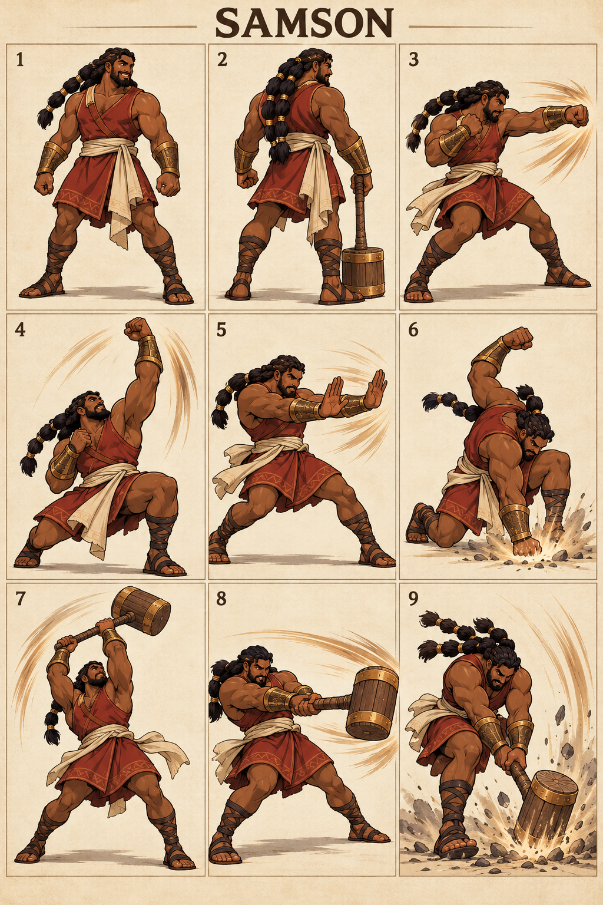

# Samson — The Strong Judge

## Character build prompt

Implement Samson as a complete playable Covenant Clash fighter. Use the master, shared physics, weapon kits and this signature specification. Finish moves and animations as independent clips; do not turn the reference sheet into a nine-frame attack. No attack is a documented biblical action unless expressly noted as context.

## Bible background

**References:** Judges 13:24–25; 14:5–6; 15:14–17; 16:28–30. A judge associated with remarkable strength given by God. Strength is represented as a fictional athlete’s silhouette; weapons and sporting moves are adaptations, not Scripture. The arena moves below are invented for this fictional sporting game. Story context is optional and separate from controls. No victory/defeat measures spiritual worth.

## Identity and visual lock

Broad muscular adult, deep brown skin, long seven-section dark braids tied safely backward, earth-red sleeveless tunic, cream sash, bronze wrist guards and a heavy wooden training mallet; no severed jawbone and no prison chains.

**Neutral posture:** Low broad stance, fists loose, shoulders relaxed, confident smile; substantial but readable weight shifts.

**Stats:** Power 8, Guard 5, Speed 2; total 15. Common capsule 40×74 units. Stats alter damage/knockback/run cap only, never frame timing. **Weakness:** Slow chase speed and punishable windups; strength never grants automatic armor.

## Generated sheet

Read panels left-to-right, top-to-bottom. They are illustrative key poses, not final runtime frames.

| Panel | Meaning |
|---|---|
| 1 | Front/idle identity |
| 2 | Back/turnaround |
| 3 | Example ordinary Light attack; family file supplies full kit |
| 4 | Gauntlets N: Lion Lift |
| 5 | Gauntlets S: Gate Rush |
| 6 | Gauntlets D: Ground Break |
| 7 | Hammer N: Pillar Rise |
| 8 | Hammer S: Heavy Resolve |
| 9 | Hammer D: Stone Step |

## Complete shared attacks

- [Gauntlets full kit](../../02_Gameplay/Weapons/gauntlets_complete_kit.md): nlight, slight, dlight, nair, sair, dair, recovery and ground pound.
- [Hammer full kit](../../02_Gameplay/Weapons/hammer_complete_kit.md): nlight, slight, dlight, nair, sair, dair, recovery and ground pound.
- [Unarmed complete kit](../../02_Gameplay/Weapons/unarmed_complete_kit.md): eight basics plus three grounded heavies.

Weapon A/B alternate on neutral pickup. Ordinary weapon lights/aerials use their family rules. The fighter-specific signatures below replace grounded weapon Heavy. All attack controls are semantic, so N/S/D mean neutral/side/down direction with Heavy on any selected input device.

## Six signatures

S/A/R = startup/active/recovery ticks at 60 Hz, before optional charge hold. Base damage precedes Power scaling. One hit per target per instance.

| Art panel | Weapon | Input | Signature | S/A/R | Damage | Role |
|---|---|---|---|---|---|---|
| 4 | Gauntlets | N+Heavy | Lion Lift | 20/5/31 | 28 | close launcher |
| 5 | Gauntlets | S+Heavy | Gate Rush | 24/6/35 | 30 | close finisher |
| 6 | Gauntlets | D+Heavy | Ground Break | 27/6/36 | 29 | ground punish |
| 7 | Hammer | N+Heavy | Pillar Rise | 24/6/34 | 29 | large anti-air |
| 8 | Hammer | S+Heavy | Heavy Resolve | 28/7/38 | 32 | heavy finisher |
| 9 | Hammer | D+Heavy | Stone Step | 30/7/39 | 30 | low space denial |

### 1. Lion Lift — gauntlets N

**What it looks like:** Samson crouches, then rises with one powerful uppercut; the other fist guards his ribs.

**Timeline:** ticks 0–19 prepare; 20–24 active; 25–55 recover. Hold grounded Heavy extends the anticipation by at most 36 ticks, with no free invulnerability. Aerial use needs the valid neutral-dodge cancel; ordinary airborne Heavy remains the family recovery/ground-pound.

**Simulation:** base damage 28, hitstun 22 ticks, base force 1280 Q/tick, growth 10 Q per whole damage unit, launch 90° with facing mirror. No scripted body translation; the attack reaches through the prop/limb animation only. Initial local contact rectangle: [-23, 40, 45, 125] design units; refine the prototype envelope against final animation.

**Purpose and counterplay:** Close Launcher. Leave the contact region before active frames, then punish the exposed ending pose. No armor protects this move. Whiff recovery is paid in full; no signature chain-cancel. Test opponents at low/high damage, edge spacing, mirrored facing and near a platform side.

**Animator instruction:** show one readable anticipation, one distinct contact silhouette and one vulnerable finish. Keep face, costume and foot pivot consistent with panels 1–2. Panel 4 illustrates the intended contact, not the whole animation or an exact trajectory.

### 2. Gate Rush — gauntlets S

**What it looks like:** Samson takes one forceful step and strikes forward with both guarded palms; no grab or cinematic lock.

**Timeline:** ticks 0–23 prepare; 24–29 active; 30–64 recover. Hold grounded Heavy extends the anticipation by at most 36 ticks, with no free invulnerability. Aerial use needs the valid neutral-dodge cancel; ordinary airborne Heavy remains the family recovery/ground-pound.

**Simulation:** base damage 30, hitstun 22 ticks, base force 1280 Q/tick, growth 10 Q per whole damage unit, launch 22° with facing mirror. The fighter advances 6 design units per active tick, stopped by solid collision. Initial local contact rectangle: [24, 24, 115, 65] design units; refine the prototype envelope against final animation.

**Purpose and counterplay:** Close Finisher. Leave the contact region before active frames, then punish the exposed ending pose. No armor protects this move. Whiff recovery is paid in full; no signature chain-cancel. Test opponents at low/high damage, edge spacing, mirrored facing and near a platform side.

**Animator instruction:** show one readable anticipation, one distinct contact silhouette and one vulnerable finish. Keep face, costume and foot pivot consistent with panels 1–2. Panel 5 illustrates the intended contact, not the whole animation or an exact trajectory.

### 3. Ground Break — gauntlets D

**What it looks like:** Samson raises one fist, drops to a knee, and strikes the training floor in front; a short dust fan marks impact.

**Timeline:** ticks 0–26 prepare; 27–32 active; 33–68 recover. Hold grounded Heavy extends the anticipation by at most 36 ticks, with no free invulnerability. Aerial use needs the valid neutral-dodge cancel; ordinary airborne Heavy remains the family recovery/ground-pound.

**Simulation:** base damage 29, hitstun 22 ticks, base force 1280 Q/tick, growth 10 Q per whole damage unit, launch 45° with facing mirror. No scripted body translation; the attack reaches through the prop/limb animation only. Initial local contact rectangle: [20, 0, 95, 18] design units; refine the prototype envelope against final animation.

**Purpose and counterplay:** Ground Punish. Leave the contact region before active frames, then punish the exposed ending pose. No armor protects this move. Whiff recovery is paid in full; no signature chain-cancel. Test opponents at low/high damage, edge spacing, mirrored facing and near a platform side.

**Animator instruction:** show one readable anticipation, one distinct contact silhouette and one vulnerable finish. Keep face, costume and foot pivot consistent with panels 1–2. Panel 6 illustrates the intended contact, not the whole animation or an exact trajectory.

### 4. Pillar Rise — hammer N

**What it looks like:** Samson pulls his wooden mallet from low behind to high overhead in a steep upward arc.

**Timeline:** ticks 0–23 prepare; 24–29 active; 30–63 recover. Hold grounded Heavy extends the anticipation by at most 36 ticks, with no free invulnerability. Aerial use needs the valid neutral-dodge cancel; ordinary airborne Heavy remains the family recovery/ground-pound.

**Simulation:** base damage 29, hitstun 22 ticks, base force 1280 Q/tick, growth 10 Q per whole damage unit, launch 90° with facing mirror. No scripted body translation; the attack reaches through the prop/limb animation only. Initial local contact rectangle: [-30, 40, 60, 145] design units; refine the prototype envelope against final animation.

**Purpose and counterplay:** Large Anti-Air. Leave the contact region before active frames, then punish the exposed ending pose. No armor protects this move. Whiff recovery is paid in full; no signature chain-cancel. Test opponents at low/high damage, edge spacing, mirrored facing and near a platform side.

**Animator instruction:** show one readable anticipation, one distinct contact silhouette and one vulnerable finish. Keep face, costume and foot pivot consistent with panels 1–2. Panel 7 illustrates the intended contact, not the whole animation or an exact trajectory.

### 5. Heavy Resolve — hammer S

**What it looks like:** Samson rotates his hips into one massive sideward mallet swing; both feet remain visible.

**Timeline:** ticks 0–27 prepare; 28–34 active; 35–72 recover. Hold grounded Heavy extends the anticipation by at most 36 ticks, with no free invulnerability. Aerial use needs the valid neutral-dodge cancel; ordinary airborne Heavy remains the family recovery/ground-pound.

**Simulation:** base damage 32, hitstun 22 ticks, base force 1280 Q/tick, growth 10 Q per whole damage unit, launch 22° with facing mirror. No scripted body translation; the attack reaches through the prop/limb animation only. Initial local contact rectangle: [24, 24, 145, 65] design units; refine the prototype envelope against final animation.

**Purpose and counterplay:** Heavy Finisher. Leave the contact region before active frames, then punish the exposed ending pose. No armor protects this move. Whiff recovery is paid in full; no signature chain-cancel. Test opponents at low/high damage, edge spacing, mirrored facing and near a platform side.

**Animator instruction:** show one readable anticipation, one distinct contact silhouette and one vulnerable finish. Keep face, costume and foot pivot consistent with panels 1–2. Panel 8 illustrates the intended contact, not the whole animation or an exact trajectory.

### 6. Stone Step — hammer D

**What it looks like:** Samson stomps forward, lowers his center of gravity, and drives the mallet into the floor ahead; dust is decorative only.

**Timeline:** ticks 0–29 prepare; 30–36 active; 37–75 recover. Hold grounded Heavy extends the anticipation by at most 36 ticks, with no free invulnerability. Aerial use needs the valid neutral-dodge cancel; ordinary airborne Heavy remains the family recovery/ground-pound.

**Simulation:** base damage 30, hitstun 22 ticks, base force 1280 Q/tick, growth 10 Q per whole damage unit, launch 45° with facing mirror. No scripted body translation; the attack reaches through the prop/limb animation only. Initial local contact rectangle: [20, 0, 120, 15] design units; refine the prototype envelope against final animation.

**Purpose and counterplay:** Low Space Denial. Leave the contact region before active frames, then punish the exposed ending pose. No armor protects this move. Whiff recovery is paid in full; no signature chain-cancel. Test opponents at low/high damage, edge spacing, mirrored facing and near a platform side.

**Animator instruction:** show one readable anticipation, one distinct contact silhouette and one vulnerable finish. Keep face, costume and foot pivot consistent with panels 1–2. Panel 9 illustrates the intended contact, not the whole animation or an exact trajectory.

## Gameplay personality

Use the strengths shown by the weapon pairing while preserving the stated weakness. Start practice with movement and family lights; use signatures as deliberate reads or punishers. Recovery and dodging use the exact shared resource rules. No character-exclusive miracle, invulnerability, teammate buff or hidden auto-aim. Cosmetics must keep the weapon and player marker readable.

## Required character output and verification

Portrait, selection icon, model/turnaround, weapon A/B/unarmed locomotion, defense/item animations, all family attacks and six signature timelines, atlas/rig metadata, valid attack IDs and replay tests. Check both facing directions, every input method, idle-to-attack transition, getting hit mid-charge, weapon throw/pickup and ring-out/respawn. Review face, hands, grip, costume continuity, pivot and tiny-screen silhouette. Final asset readiness must be recorded; the supplied PNG is concept art.

## ELI5

Samson has two sets of tools. Pick up a tool, then use direction plus Light or Heavy. Big moves hit harder but leave a longer opening if you miss. Good timing beats button spam.
