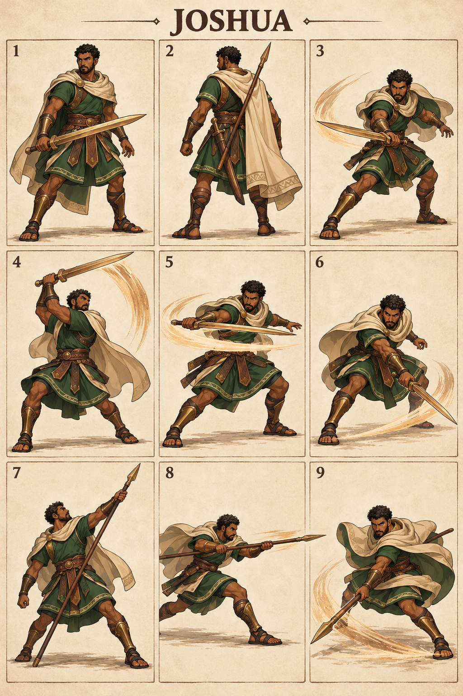

# Joshua — The Steadfast Leader

## Character build prompt

Implement Joshua as a complete playable Covenant Clash fighter. Use the master, shared physics, weapon kits and this signature specification. Finish moves and animations as independent clips; do not turn the reference sheet into a nine-frame attack. No attack is a documented biblical action unless expressly noted as context.

## Bible background

**References:** Joshua 1:6–9; 5:13–15; 6:1–20. Led Israel after Moses; courage and obedience anchor the profile. God’s victory at Jericho is not reduced to a magic sword attack. The arena moves below are invented for this fictional sporting game. Story context is optional and separate from controls. No victory/defeat measures spiritual worth.

## Identity and visual lock

Athletic mature adult, bronze-brown complexion, short black curls, trimmed beard, forest-green tunic, sand-colored cloak pinned at shoulder, leather armor and bronze sword; compact balanced silhouette.

**Neutral posture:** Centered athletic guard, sword angled forward, cloak gathered behind; disciplined efficient movement.

**Stats:** Power 5, Guard 5, Speed 5; total 15. Common capsule 40×74 units. Stats alter damage/knockback/run cap only, never frame timing. **Weakness:** Balanced stats offer no specialist advantage; linear signatures are easy to read.

## Generated sheet

Read panels left-to-right, top-to-bottom. They are illustrative key poses, not final runtime frames.

| Panel | Meaning |
|---|---|
| 1 | Front/idle identity |
| 2 | Back/turnaround |
| 3 | Example ordinary Light attack; family file supplies full kit |
| 4 | Sword N: Courage Ascends |
| 5 | Sword S: Forward Standard |
| 6 | Sword D: Measured Ground |
| 7 | Spear N: Banner Rise |
| 8 | Spear S: Line Advance |
| 9 | Spear D: Boundary Turn |

## Complete shared attacks

- [Sword full kit](../../02_Gameplay/Weapons/sword_complete_kit.md): nlight, slight, dlight, nair, sair, dair, recovery and ground pound.
- [Spear full kit](../../02_Gameplay/Weapons/spear_complete_kit.md): nlight, slight, dlight, nair, sair, dair, recovery and ground pound.
- [Unarmed complete kit](../../02_Gameplay/Weapons/unarmed_complete_kit.md): eight basics plus three grounded heavies.

Weapon A/B alternate on neutral pickup. Ordinary weapon lights/aerials use their family rules. The fighter-specific signatures below replace grounded weapon Heavy. All attack controls are semantic, so N/S/D mean neutral/side/down direction with Heavy on any selected input device.

## Six signatures

S/A/R = startup/active/recovery ticks at 60 Hz, before optional charge hold. Base damage precedes Power scaling. One hit per target per instance.

| Art panel | Weapon | Input | Signature | S/A/R | Damage | Role |
|---|---|---|---|---|---|---|
| 4 | Sword | N+Heavy | Courage Ascends | 18/5/25 | 25 | anti-air |
| 5 | Sword | S+Heavy | Forward Standard | 22/5/29 | 28 | lane finisher |
| 6 | Sword | D+Heavy | Measured Ground | 24/6/31 | 26 | low punish |
| 7 | Spear | N+Heavy | Banner Rise | 20/5/27 | 26 | vertical control |
| 8 | Spear | S+Heavy | Line Advance | 23/5/31 | 28 | spacing finisher |
| 9 | Spear | D+Heavy | Boundary Turn | 25/6/32 | 26 | low spacing |

### 1. Courage Ascends — sword N

**What it looks like:** Joshua makes a disciplined rising diagonal cut and ends with the blade above his brow.

**Timeline:** ticks 0–17 prepare; 18–22 active; 23–47 recover. Hold grounded Heavy extends the anticipation by at most 36 ticks, with no free invulnerability. Aerial use needs the valid neutral-dodge cancel; ordinary airborne Heavy remains the family recovery/ground-pound.

**Simulation:** base damage 25, hitstun 22 ticks, base force 1280 Q/tick, growth 10 Q per whole damage unit, launch 67° with facing mirror. No scripted body translation; the attack reaches through the prop/limb animation only. Initial local contact rectangle: [-30, 40, 60, 130] design units; refine the prototype envelope against final animation.

**Purpose and counterplay:** Anti-Air. Leave the contact region before active frames, then punish the exposed ending pose. No armor protects this move. Whiff recovery is paid in full; no signature chain-cancel. Test opponents at low/high damage, edge spacing, mirrored facing and near a platform side.

**Animator instruction:** show one readable anticipation, one distinct contact silhouette and one vulnerable finish. Keep face, costume and foot pivot consistent with panels 1–2. Panel 4 illustrates the intended contact, not the whole animation or an exact trajectory.

### 2. Forward Standard — sword S

**What it looks like:** Joshua steps behind his leading elbow and completes one long horizontal sword cut.

**Timeline:** ticks 0–21 prepare; 22–26 active; 27–55 recover. Hold grounded Heavy extends the anticipation by at most 36 ticks, with no free invulnerability. Aerial use needs the valid neutral-dodge cancel; ordinary airborne Heavy remains the family recovery/ground-pound.

**Simulation:** base damage 28, hitstun 22 ticks, base force 1280 Q/tick, growth 10 Q per whole damage unit, launch 22° with facing mirror. The fighter advances 6 design units per active tick, stopped by solid collision. Initial local contact rectangle: [24, 24, 120, 55] design units; refine the prototype envelope against final animation.

**Purpose and counterplay:** Lane Finisher. Leave the contact region before active frames, then punish the exposed ending pose. No armor protects this move. Whiff recovery is paid in full; no signature chain-cancel. Test opponents at low/high damage, edge spacing, mirrored facing and near a platform side.

**Animator instruction:** show one readable anticipation, one distinct contact silhouette and one vulnerable finish. Keep face, costume and foot pivot consistent with panels 1–2. Panel 5 illustrates the intended contact, not the whole animation or an exact trajectory.

### 3. Measured Ground — sword D

**What it looks like:** Joshua makes a low controlled slash and returns to guard without an extra follow-up hit.

**Timeline:** ticks 0–23 prepare; 24–29 active; 30–60 recover. Hold grounded Heavy extends the anticipation by at most 36 ticks, with no free invulnerability. Aerial use needs the valid neutral-dodge cancel; ordinary airborne Heavy remains the family recovery/ground-pound.

**Simulation:** base damage 26, hitstun 22 ticks, base force 1280 Q/tick, growth 10 Q per whole damage unit, launch 22° with facing mirror. No scripted body translation; the attack reaches through the prop/limb animation only. Initial local contact rectangle: [20, 0, 110, 18] design units; refine the prototype envelope against final animation.

**Purpose and counterplay:** Low Punish. Leave the contact region before active frames, then punish the exposed ending pose. No armor protects this move. Whiff recovery is paid in full; no signature chain-cancel. Test opponents at low/high damage, edge spacing, mirrored facing and near a platform side.

**Animator instruction:** show one readable anticipation, one distinct contact silhouette and one vulnerable finish. Keep face, costume and foot pivot consistent with panels 1–2. Panel 6 illustrates the intended contact, not the whole animation or an exact trajectory.

### 4. Banner Rise — spear N

**What it looks like:** Joshua plants the butt of his spear near his foot and thrusts the point upward with an extended rear arm.

**Timeline:** ticks 0–19 prepare; 20–24 active; 25–51 recover. Hold grounded Heavy extends the anticipation by at most 36 ticks, with no free invulnerability. Aerial use needs the valid neutral-dodge cancel; ordinary airborne Heavy remains the family recovery/ground-pound.

**Simulation:** base damage 26, hitstun 22 ticks, base force 1280 Q/tick, growth 10 Q per whole damage unit, launch 90° with facing mirror. No scripted body translation; the attack reaches through the prop/limb animation only. Initial local contact rectangle: [10, 40, 30, 145] design units; refine the prototype envelope against final animation.

**Purpose and counterplay:** Vertical Control. Leave the contact region before active frames, then punish the exposed ending pose. No armor protects this move. Whiff recovery is paid in full; no signature chain-cancel. Test opponents at low/high damage, edge spacing, mirrored facing and near a platform side.

**Animator instruction:** show one readable anticipation, one distinct contact silhouette and one vulnerable finish. Keep face, costume and foot pivot consistent with panels 1–2. Panel 7 illustrates the intended contact, not the whole animation or an exact trajectory.

### 5. Line Advance — spear S

**What it looks like:** Joshua makes a short lunge and releases one precise spear thrust into the front lane.

**Timeline:** ticks 0–22 prepare; 23–27 active; 28–58 recover. Hold grounded Heavy extends the anticipation by at most 36 ticks, with no free invulnerability. Aerial use needs the valid neutral-dodge cancel; ordinary airborne Heavy remains the family recovery/ground-pound.

**Simulation:** base damage 28, hitstun 22 ticks, base force 1280 Q/tick, growth 10 Q per whole damage unit, launch 22° with facing mirror. The fighter advances 6 design units per active tick, stopped by solid collision. Initial local contact rectangle: [24, 24, 155, 55] design units; refine the prototype envelope against final animation.

**Purpose and counterplay:** Spacing Finisher. Leave the contact region before active frames, then punish the exposed ending pose. No armor protects this move. Whiff recovery is paid in full; no signature chain-cancel. Test opponents at low/high damage, edge spacing, mirrored facing and near a platform side.

**Animator instruction:** show one readable anticipation, one distinct contact silhouette and one vulnerable finish. Keep face, costume and foot pivot consistent with panels 1–2. Panel 8 illustrates the intended contact, not the whole animation or an exact trajectory.

### 6. Boundary Turn — spear D

**What it looks like:** Joshua pivots on his back foot and sweeps the spear tip low in front, green cloak wrapping around his hips.

**Timeline:** ticks 0–24 prepare; 25–30 active; 31–62 recover. Hold grounded Heavy extends the anticipation by at most 36 ticks, with no free invulnerability. Aerial use needs the valid neutral-dodge cancel; ordinary airborne Heavy remains the family recovery/ground-pound.

**Simulation:** base damage 26, hitstun 22 ticks, base force 1280 Q/tick, growth 10 Q per whole damage unit, launch 22° with facing mirror. No scripted body translation; the attack reaches through the prop/limb animation only. Initial local contact rectangle: [20, 0, 145, 20] design units; refine the prototype envelope against final animation.

**Purpose and counterplay:** Low Spacing. Leave the contact region before active frames, then punish the exposed ending pose. No armor protects this move. Whiff recovery is paid in full; no signature chain-cancel. Test opponents at low/high damage, edge spacing, mirrored facing and near a platform side.

**Animator instruction:** show one readable anticipation, one distinct contact silhouette and one vulnerable finish. Keep face, costume and foot pivot consistent with panels 1–2. Panel 9 illustrates the intended contact, not the whole animation or an exact trajectory.

## Gameplay personality

Use the strengths shown by the weapon pairing while preserving the stated weakness. Start practice with movement and family lights; use signatures as deliberate reads or punishers. Recovery and dodging use the exact shared resource rules. No character-exclusive miracle, invulnerability, teammate buff or hidden auto-aim. Cosmetics must keep the weapon and player marker readable.

## Required character output and verification

Portrait, selection icon, model/turnaround, weapon A/B/unarmed locomotion, defense/item animations, all family attacks and six signature timelines, atlas/rig metadata, valid attack IDs and replay tests. Check both facing directions, every input method, idle-to-attack transition, getting hit mid-charge, weapon throw/pickup and ring-out/respawn. Review face, hands, grip, costume continuity, pivot and tiny-screen silhouette. Final asset readiness must be recorded; the supplied PNG is concept art.

## ELI5

Joshua has two sets of tools. Pick up a tool, then use direction plus Light or Heavy. Big moves hit harder but leave a longer opening if you miss. Good timing beats button spam.
