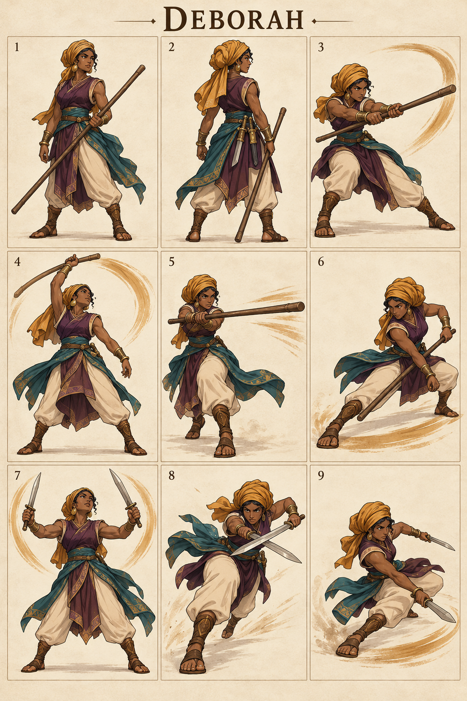

# Deborah — The Resolute Judge

## Character build prompt

Implement Deborah as a complete playable Covenant Clash fighter. Use the master, shared physics, weapon kits and this signature specification. Finish moves and animations as independent clips; do not turn the reference sheet into a nine-frame attack. No attack is a documented biblical action unless expressly noted as context.

## Bible background

**References:** Judges 4:4–10; 5:1–31. A prophetess and judge who encouraged Barak. These staff and blade arena moves are fictional; the text does not describe her fighting this way. The arena moves below are invented for this fictional sporting game. Story context is optional and separate from controls. No victory/defeat measures spiritual worth.

## Identity and visual lock

Confident mature woman, dark brown complexion, dignified ochre headwrap secured above shoulders, plum tunic, cream trousers, teal waist sash, simple bronze bangles; wooden staff and paired short practice blades.

**Neutral posture:** Staff balanced diagonally, calm alert posture; crisp decisive movement, no magical prophecy projectiles.

**Stats:** Power 3, Guard 5, Speed 7; total 15. Common capsule 40×74 units. Stats alter damage/knockback/run cap only, never frame timing. **Weakness:** Low finishing power; wide staff whiffs can be punished up close.

## Generated sheet

Read panels left-to-right, top-to-bottom. They are illustrative key poses, not final runtime frames.

| Panel | Meaning |
|---|---|
| 1 | Front/idle identity |
| 2 | Back/turnaround |
| 3 | Example ordinary Light attack; family file supplies full kit |
| 4 | Staff N: Palm Rise |
| 5 | Staff S: Clear Direction |
| 6 | Staff D: Steady Counsel |
| 7 | Blades N: Decisive Lift |
| 8 | Blades S: Swift Verdict |
| 9 | Blades D: Low Balance |

## Complete shared attacks

- [Staff full kit](../../02_Gameplay/Weapons/staff_complete_kit.md): nlight, slight, dlight, nair, sair, dair, recovery and ground pound.
- [Blades full kit](../../02_Gameplay/Weapons/blades_complete_kit.md): nlight, slight, dlight, nair, sair, dair, recovery and ground pound.
- [Unarmed complete kit](../../02_Gameplay/Weapons/unarmed_complete_kit.md): eight basics plus three grounded heavies.

Weapon A/B alternate on neutral pickup. Ordinary weapon lights/aerials use their family rules. The fighter-specific signatures below replace grounded weapon Heavy. All attack controls are semantic, so N/S/D mean neutral/side/down direction with Heavy on any selected input device.

## Six signatures

S/A/R = startup/active/recovery ticks at 60 Hz, before optional charge hold. Base damage precedes Power scaling. One hit per target per instance.

| Art panel | Weapon | Input | Signature | S/A/R | Damage | Role |
|---|---|---|---|---|---|---|
| 4 | Staff | N+Heavy | Palm Rise | 17/5/25 | 23 | anti-air |
| 5 | Staff | S+Heavy | Clear Direction | 21/5/28 | 25 | spacing punish |
| 6 | Staff | D+Heavy | Steady Counsel | 23/6/30 | 24 | ground control |
| 7 | Blades | N+Heavy | Decisive Lift | 16/5/24 | 23 | close anti-air |
| 8 | Blades | S+Heavy | Swift Verdict | 20/5/29 | 25 | close finisher |
| 9 | Blades | D+Heavy | Low Balance | 24/5/31 | 24 | retreat punish |

### 1. Palm Rise — staff N

**What it looks like:** Deborah rotates a wooden staff upward past her shoulder in an open fan arc, sash trailing.

**Timeline:** ticks 0–16 prepare; 17–21 active; 22–46 recover. Hold grounded Heavy extends the anticipation by at most 36 ticks, with no free invulnerability. Aerial use needs the valid neutral-dodge cancel; ordinary airborne Heavy remains the family recovery/ground-pound.

**Simulation:** base damage 23, hitstun 22 ticks, base force 1280 Q/tick, growth 10 Q per whole damage unit, launch 67° with facing mirror. No scripted body translation; the attack reaches through the prop/limb animation only. Initial local contact rectangle: [-38, 40, 75, 140] design units; refine the prototype envelope against final animation.

**Purpose and counterplay:** Anti-Air. Leave the contact region before active frames, then punish the exposed ending pose. No armor protects this move. Whiff recovery is paid in full; no signature chain-cancel. Test opponents at low/high damage, edge spacing, mirrored facing and near a platform side.

**Animator instruction:** show one readable anticipation, one distinct contact silhouette and one vulnerable finish. Keep face, costume and foot pivot consistent with panels 1–2. Panel 4 illustrates the intended contact, not the whole animation or an exact trajectory.

### 2. Clear Direction — staff S

**What it looks like:** Deborah shifts one foot forward and snaps the staff horizontally into a long front-facing strike.

**Timeline:** ticks 0–20 prepare; 21–25 active; 26–53 recover. Hold grounded Heavy extends the anticipation by at most 36 ticks, with no free invulnerability. Aerial use needs the valid neutral-dodge cancel; ordinary airborne Heavy remains the family recovery/ground-pound.

**Simulation:** base damage 25, hitstun 22 ticks, base force 1280 Q/tick, growth 10 Q per whole damage unit, launch 22° with facing mirror. No scripted body translation; the attack reaches through the prop/limb animation only. Initial local contact rectangle: [24, 24, 145, 60] design units; refine the prototype envelope against final animation.

**Purpose and counterplay:** Spacing Punish. Leave the contact region before active frames, then punish the exposed ending pose. No armor protects this move. Whiff recovery is paid in full; no signature chain-cancel. Test opponents at low/high damage, edge spacing, mirrored facing and near a platform side.

**Animator instruction:** show one readable anticipation, one distinct contact silhouette and one vulnerable finish. Keep face, costume and foot pivot consistent with panels 1–2. Panel 5 illustrates the intended contact, not the whole animation or an exact trajectory.

### 3. Steady Counsel — staff D

**What it looks like:** Deborah lowers to a side stance and sweeps the far end of the staff along a low front arc.

**Timeline:** ticks 0–22 prepare; 23–28 active; 29–58 recover. Hold grounded Heavy extends the anticipation by at most 36 ticks, with no free invulnerability. Aerial use needs the valid neutral-dodge cancel; ordinary airborne Heavy remains the family recovery/ground-pound.

**Simulation:** base damage 24, hitstun 22 ticks, base force 1280 Q/tick, growth 10 Q per whole damage unit, launch 22° with facing mirror. No scripted body translation; the attack reaches through the prop/limb animation only. Initial local contact rectangle: [20, 0, 145, 18] design units; refine the prototype envelope against final animation.

**Purpose and counterplay:** Ground Control. Leave the contact region before active frames, then punish the exposed ending pose. No armor protects this move. Whiff recovery is paid in full; no signature chain-cancel. Test opponents at low/high damage, edge spacing, mirrored facing and near a platform side.

**Animator instruction:** show one readable anticipation, one distinct contact silhouette and one vulnerable finish. Keep face, costume and foot pivot consistent with panels 1–2. Panel 6 illustrates the intended contact, not the whole animation or an exact trajectory.

### 4. Decisive Lift — blades N

**What it looks like:** Deborah crosses her practice blades at waist height and separates them in one rising V-shaped cut.

**Timeline:** ticks 0–15 prepare; 16–20 active; 21–44 recover. Hold grounded Heavy extends the anticipation by at most 36 ticks, with no free invulnerability. Aerial use needs the valid neutral-dodge cancel; ordinary airborne Heavy remains the family recovery/ground-pound.

**Simulation:** base damage 23, hitstun 22 ticks, base force 1280 Q/tick, growth 10 Q per whole damage unit, launch 90° with facing mirror. No scripted body translation; the attack reaches through the prop/limb animation only. Initial local contact rectangle: [-23, 40, 45, 110] design units; refine the prototype envelope against final animation.

**Purpose and counterplay:** Close Anti-Air. Leave the contact region before active frames, then punish the exposed ending pose. No armor protects this move. Whiff recovery is paid in full; no signature chain-cancel. Test opponents at low/high damage, edge spacing, mirrored facing and near a platform side.

**Animator instruction:** show one readable anticipation, one distinct contact silhouette and one vulnerable finish. Keep face, costume and foot pivot consistent with panels 1–2. Panel 7 illustrates the intended contact, not the whole animation or an exact trajectory.

### 5. Swift Verdict — blades S

**What it looks like:** Deborah dashes a short distance and makes one crossed forward blade strike, finishing in a stable stance.

**Timeline:** ticks 0–19 prepare; 20–24 active; 25–53 recover. Hold grounded Heavy extends the anticipation by at most 36 ticks, with no free invulnerability. Aerial use needs the valid neutral-dodge cancel; ordinary airborne Heavy remains the family recovery/ground-pound.

**Simulation:** base damage 25, hitstun 22 ticks, base force 1280 Q/tick, growth 10 Q per whole damage unit, launch 22° with facing mirror. The fighter advances 6 design units per active tick, stopped by solid collision. Initial local contact rectangle: [24, 24, 105, 55] design units; refine the prototype envelope against final animation.

**Purpose and counterplay:** Close Finisher. Leave the contact region before active frames, then punish the exposed ending pose. No armor protects this move. Whiff recovery is paid in full; no signature chain-cancel. Test opponents at low/high damage, edge spacing, mirrored facing and near a platform side.

**Animator instruction:** show one readable anticipation, one distinct contact silhouette and one vulnerable finish. Keep face, costume and foot pivot consistent with panels 1–2. Panel 8 illustrates the intended contact, not the whole animation or an exact trajectory.

### 6. Low Balance — blades D

**What it looks like:** Deborah slips backward during anticipation, then turns a blade through a low front sweep.

**Timeline:** ticks 0–23 prepare; 24–28 active; 29–59 recover. Hold grounded Heavy extends the anticipation by at most 36 ticks, with no free invulnerability. Aerial use needs the valid neutral-dodge cancel; ordinary airborne Heavy remains the family recovery/ground-pound.

**Simulation:** base damage 24, hitstun 22 ticks, base force 1280 Q/tick, growth 10 Q per whole damage unit, launch 22° with facing mirror. The fighter retreats 4 units per tick during the final 6 startup ticks, stopped by solid geometry. Initial local contact rectangle: [20, 0, 95, 18] design units; refine the prototype envelope against final animation.

**Purpose and counterplay:** Retreat Punish. Leave the contact region before active frames, then punish the exposed ending pose. No armor protects this move. Whiff recovery is paid in full; no signature chain-cancel. Test opponents at low/high damage, edge spacing, mirrored facing and near a platform side.

**Animator instruction:** show one readable anticipation, one distinct contact silhouette and one vulnerable finish. Keep face, costume and foot pivot consistent with panels 1–2. Panel 9 illustrates the intended contact, not the whole animation or an exact trajectory.

## Gameplay personality

Use the strengths shown by the weapon pairing while preserving the stated weakness. Start practice with movement and family lights; use signatures as deliberate reads or punishers. Recovery and dodging use the exact shared resource rules. No character-exclusive miracle, invulnerability, teammate buff or hidden auto-aim. Cosmetics must keep the weapon and player marker readable.

## Required character output and verification

Portrait, selection icon, model/turnaround, weapon A/B/unarmed locomotion, defense/item animations, all family attacks and six signature timelines, atlas/rig metadata, valid attack IDs and replay tests. Check both facing directions, every input method, idle-to-attack transition, getting hit mid-charge, weapon throw/pickup and ring-out/respawn. Review face, hands, grip, costume continuity, pivot and tiny-screen silhouette. Final asset readiness must be recorded; the supplied PNG is concept art.

## ELI5

Deborah has two sets of tools. Pick up a tool, then use direction plus Light or Heavy. Big moves hit harder but leave a longer opening if you miss. Good timing beats button spam.
