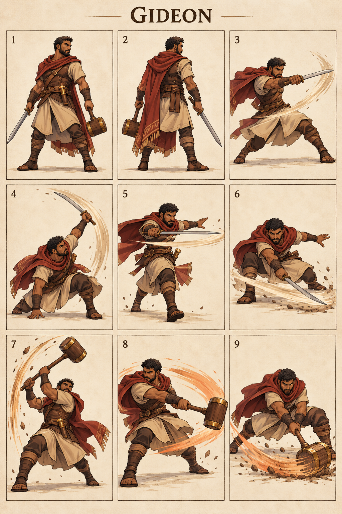

# Gideon — The Courageous Few

## Character build prompt

Implement Gideon as a complete playable Covenant Clash fighter. Use the master, shared physics, weapon kits and this signature specification. Finish moves and animations as independent clips; do not turn the reference sheet into a nine-frame attack. No attack is a documented biblical action unless expressly noted as context.

## Bible background

**References:** Judges 6:11–16; 7:16–22; 8:22–27. Called by God despite fear and associated with the three hundred. Trumpets, jars and torch shapes are visual motifs; they do not become automatic miracles. The arena moves below are invented for this fictional sporting game. Story context is optional and separate from controls. No victory/defeat measures spiritual worth.

## Identity and visual lock

Adult man with olive-brown skin, close dark hair and short beard, rust-red mantle over tan tunic, leather vest, unlit torch-shaped belt ornament and a bronze-capped wooden mallet; modest rounded silhouette.

**Neutral posture:** Compact guard, eyes watchful, weight on back foot; measured attacks with bold finishing poses.

**Stats:** Power 5, Guard 6, Speed 4; total 15. Common capsule 40×74 units. Stats alter damage/knockback/run cap only, never frame timing. **Weakness:** Moderate reach and speed; long mallet commitments create openings.

## Generated sheet

Read panels left-to-right, top-to-bottom. They are illustrative key poses, not final runtime frames.

| Panel | Meaning |
|---|---|
| 1 | Front/idle identity |
| 2 | Back/turnaround |
| 3 | Example ordinary Light attack; family file supplies full kit |
| 4 | Sword N: Waking Courage |
| 5 | Sword S: Three Hundred Step |
| 6 | Sword D: Watchman Sweep |
| 7 | Hammer N: Jarbreak Lift |
| 8 | Hammer S: Torchline Strike |
| 9 | Hammer D: Camp Boundary |

## Complete shared attacks

- [Sword full kit](../../02_Gameplay/Weapons/sword_complete_kit.md): nlight, slight, dlight, nair, sair, dair, recovery and ground pound.
- [Hammer full kit](../../02_Gameplay/Weapons/hammer_complete_kit.md): nlight, slight, dlight, nair, sair, dair, recovery and ground pound.
- [Unarmed complete kit](../../02_Gameplay/Weapons/unarmed_complete_kit.md): eight basics plus three grounded heavies.

Weapon A/B alternate on neutral pickup. Ordinary weapon lights/aerials use their family rules. The fighter-specific signatures below replace grounded weapon Heavy. All attack controls are semantic, so N/S/D mean neutral/side/down direction with Heavy on any selected input device.

## Six signatures

S/A/R = startup/active/recovery ticks at 60 Hz, before optional charge hold. Base damage precedes Power scaling. One hit per target per instance.

| Art panel | Weapon | Input | Signature | S/A/R | Damage | Role |
|---|---|---|---|---|---|---|
| 4 | Sword | N+Heavy | Waking Courage | 19/5/27 | 25 | anti-air |
| 5 | Sword | S+Heavy | Three Hundred Step | 23/5/31 | 28 | lane punish |
| 6 | Sword | D+Heavy | Watchman Sweep | 25/6/33 | 26 | ground finisher |
| 7 | Hammer | N+Heavy | Jarbreak Lift | 23/6/32 | 27 | close anti-air |
| 8 | Hammer | S+Heavy | Torchline Strike | 27/6/36 | 30 | heavy finisher |
| 9 | Hammer | D+Heavy | Camp Boundary | 28/6/37 | 28 | low control |

### 1. Waking Courage — sword N

**What it looks like:** Gideon moves from a low guarded stance into a sudden rising sword arc.

**Timeline:** ticks 0–18 prepare; 19–23 active; 24–50 recover. Hold grounded Heavy extends the anticipation by at most 36 ticks, with no free invulnerability. Aerial use needs the valid neutral-dodge cancel; ordinary airborne Heavy remains the family recovery/ground-pound.

**Simulation:** base damage 25, hitstun 22 ticks, base force 1280 Q/tick, growth 10 Q per whole damage unit, launch 67° with facing mirror. No scripted body translation; the attack reaches through the prop/limb animation only. Initial local contact rectangle: [-30, 40, 60, 125] design units; refine the prototype envelope against final animation.

**Purpose and counterplay:** Anti-Air. Leave the contact region before active frames, then punish the exposed ending pose. No armor protects this move. Whiff recovery is paid in full; no signature chain-cancel. Test opponents at low/high damage, edge spacing, mirrored facing and near a platform side.

**Animator instruction:** show one readable anticipation, one distinct contact silhouette and one vulnerable finish. Keep face, costume and foot pivot consistent with panels 1–2. Panel 4 illustrates the intended contact, not the whole animation or an exact trajectory.

### 2. Three Hundred Step — sword S

**What it looks like:** Gideon takes one assertive forward step and slashes through a narrow horizontal lane.

**Timeline:** ticks 0–22 prepare; 23–27 active; 28–58 recover. Hold grounded Heavy extends the anticipation by at most 36 ticks, with no free invulnerability. Aerial use needs the valid neutral-dodge cancel; ordinary airborne Heavy remains the family recovery/ground-pound.

**Simulation:** base damage 28, hitstun 22 ticks, base force 1280 Q/tick, growth 10 Q per whole damage unit, launch 22° with facing mirror. The fighter advances 6 design units per active tick, stopped by solid collision. Initial local contact rectangle: [24, 24, 120, 55] design units; refine the prototype envelope against final animation.

**Purpose and counterplay:** Lane Punish. Leave the contact region before active frames, then punish the exposed ending pose. No armor protects this move. Whiff recovery is paid in full; no signature chain-cancel. Test opponents at low/high damage, edge spacing, mirrored facing and near a platform side.

**Animator instruction:** show one readable anticipation, one distinct contact silhouette and one vulnerable finish. Keep face, costume and foot pivot consistent with panels 1–2. Panel 5 illustrates the intended contact, not the whole animation or an exact trajectory.

### 3. Watchman Sweep — sword D

**What it looks like:** Gideon braces his back knee and makes one low front-facing sword sweep.

**Timeline:** ticks 0–24 prepare; 25–30 active; 31–63 recover. Hold grounded Heavy extends the anticipation by at most 36 ticks, with no free invulnerability. Aerial use needs the valid neutral-dodge cancel; ordinary airborne Heavy remains the family recovery/ground-pound.

**Simulation:** base damage 26, hitstun 22 ticks, base force 1280 Q/tick, growth 10 Q per whole damage unit, launch 22° with facing mirror. No scripted body translation; the attack reaches through the prop/limb animation only. Initial local contact rectangle: [20, 0, 115, 18] design units; refine the prototype envelope against final animation.

**Purpose and counterplay:** Ground Finisher. Leave the contact region before active frames, then punish the exposed ending pose. No armor protects this move. Whiff recovery is paid in full; no signature chain-cancel. Test opponents at low/high damage, edge spacing, mirrored facing and near a platform side.

**Animator instruction:** show one readable anticipation, one distinct contact silhouette and one vulnerable finish. Keep face, costume and foot pivot consistent with panels 1–2. Panel 6 illustrates the intended contact, not the whole animation or an exact trajectory.

### 4. Jarbreak Lift — hammer N

**What it looks like:** Gideon swings his bronze-capped wooden mallet upward; small pottery-colored motion flecks are decorative.

**Timeline:** ticks 0–22 prepare; 23–28 active; 29–60 recover. Hold grounded Heavy extends the anticipation by at most 36 ticks, with no free invulnerability. Aerial use needs the valid neutral-dodge cancel; ordinary airborne Heavy remains the family recovery/ground-pound.

**Simulation:** base damage 27, hitstun 22 ticks, base force 1280 Q/tick, growth 10 Q per whole damage unit, launch 90° with facing mirror. No scripted body translation; the attack reaches through the prop/limb animation only. Initial local contact rectangle: [-30, 40, 60, 140] design units; refine the prototype envelope against final animation.

**Purpose and counterplay:** Close Anti-Air. Leave the contact region before active frames, then punish the exposed ending pose. No armor protects this move. Whiff recovery is paid in full; no signature chain-cancel. Test opponents at low/high damage, edge spacing, mirrored facing and near a platform side.

**Animator instruction:** show one readable anticipation, one distinct contact silhouette and one vulnerable finish. Keep face, costume and foot pivot consistent with panels 1–2. Panel 7 illustrates the intended contact, not the whole animation or an exact trajectory.

### 5. Torchline Strike — hammer S

**What it looks like:** Gideon turns his shoulders into a side mallet strike with a warm orange painted motion trail, not fire damage.

**Timeline:** ticks 0–26 prepare; 27–32 active; 33–68 recover. Hold grounded Heavy extends the anticipation by at most 36 ticks, with no free invulnerability. Aerial use needs the valid neutral-dodge cancel; ordinary airborne Heavy remains the family recovery/ground-pound.

**Simulation:** base damage 30, hitstun 22 ticks, base force 1280 Q/tick, growth 10 Q per whole damage unit, launch 22° with facing mirror. No scripted body translation; the attack reaches through the prop/limb animation only. Initial local contact rectangle: [24, 24, 130, 65] design units; refine the prototype envelope against final animation.

**Purpose and counterplay:** Heavy Finisher. Leave the contact region before active frames, then punish the exposed ending pose. No armor protects this move. Whiff recovery is paid in full; no signature chain-cancel. Test opponents at low/high damage, edge spacing, mirrored facing and near a platform side.

**Animator instruction:** show one readable anticipation, one distinct contact silhouette and one vulnerable finish. Keep face, costume and foot pivot consistent with panels 1–2. Panel 8 illustrates the intended contact, not the whole animation or an exact trajectory.

### 6. Camp Boundary — hammer D

**What it looks like:** Gideon drives the mallet head across the ground in a compact frontward sweep.

**Timeline:** ticks 0–27 prepare; 28–33 active; 34–70 recover. Hold grounded Heavy extends the anticipation by at most 36 ticks, with no free invulnerability. Aerial use needs the valid neutral-dodge cancel; ordinary airborne Heavy remains the family recovery/ground-pound.

**Simulation:** base damage 28, hitstun 22 ticks, base force 1280 Q/tick, growth 10 Q per whole damage unit, launch 45° with facing mirror. No scripted body translation; the attack reaches through the prop/limb animation only. Initial local contact rectangle: [20, 0, 115, 18] design units; refine the prototype envelope against final animation.

**Purpose and counterplay:** Low Control. Leave the contact region before active frames, then punish the exposed ending pose. No armor protects this move. Whiff recovery is paid in full; no signature chain-cancel. Test opponents at low/high damage, edge spacing, mirrored facing and near a platform side.

**Animator instruction:** show one readable anticipation, one distinct contact silhouette and one vulnerable finish. Keep face, costume and foot pivot consistent with panels 1–2. Panel 9 illustrates the intended contact, not the whole animation or an exact trajectory.

## Gameplay personality

Use the strengths shown by the weapon pairing while preserving the stated weakness. Start practice with movement and family lights; use signatures as deliberate reads or punishers. Recovery and dodging use the exact shared resource rules. No character-exclusive miracle, invulnerability, teammate buff or hidden auto-aim. Cosmetics must keep the weapon and player marker readable.

## Required character output and verification

Portrait, selection icon, model/turnaround, weapon A/B/unarmed locomotion, defense/item animations, all family attacks and six signature timelines, atlas/rig metadata, valid attack IDs and replay tests. Check both facing directions, every input method, idle-to-attack transition, getting hit mid-charge, weapon throw/pickup and ring-out/respawn. Review face, hands, grip, costume continuity, pivot and tiny-screen silhouette. Final asset readiness must be recorded; the supplied PNG is concept art.

## ELI5

Gideon has two sets of tools. Pick up a tool, then use direction plus Light or Heavy. Big moves hit harder but leave a longer opening if you miss. Good timing beats button spam.
