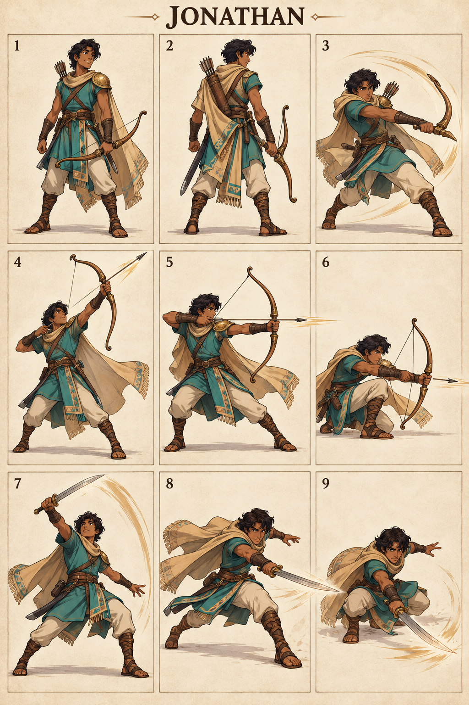

# Jonathan — The Loyal Archer

## Character build prompt

Implement Jonathan as a complete playable Covenant Clash fighter. Use the master, shared physics, weapon kits and this signature specification. Finish moves and animations as independent clips; do not turn the reference sheet into a nine-frame attack. No attack is a documented biblical action unless expressly noted as context.

## Bible background

**References:** 1 Samuel 14:1–14; 18:1–4; 20:18–42. Saul’s son, courageous warrior and loyal friend of David. Friendship is expressed in dialogue; it is not a stat buff for a specific teammate. The arena moves below are invented for this fictional sporting game. Story context is optional and separate from controls. No victory/defeat measures spiritual worth.

## Identity and visual lock

Lean young adult with medium brown skin, short wavy dark hair, turquoise tunic, brown leather chest straps, sand cape, small bronze shoulder plate, curved wooden bow and light sword; quick narrow silhouette.

**Neutral posture:** Bow low and relaxed, knees springy; alert friendly expression and agile clean poses.

**Stats:** Power 4, Guard 3, Speed 8; total 15. Common capsule 40×74 units. Stats alter damage/knockback/run cap only, never frame timing. **Weakness:** Light survivability and exploitable projectile recovery.

## Generated sheet

Read panels left-to-right, top-to-bottom. They are illustrative key poses, not final runtime frames.

| Panel | Meaning |
|---|---|
| 1 | Front/idle identity |
| 2 | Back/turnaround |
| 3 | Example ordinary Light attack; family file supplies full kit |
| 4 | Bow N: High Signal |
| 5 | Bow S: Arrow Message |
| 6 | Bow D: Low Watch |
| 7 | Sword N: Loyal Rise |
| 8 | Sword S: Friend’s Resolve |
| 9 | Sword D: Covering Sweep |

## Complete shared attacks

- [Bow full kit](../../02_Gameplay/Weapons/bow_complete_kit.md): nlight, slight, dlight, nair, sair, dair, recovery and ground pound.
- [Sword full kit](../../02_Gameplay/Weapons/sword_complete_kit.md): nlight, slight, dlight, nair, sair, dair, recovery and ground pound.
- [Unarmed complete kit](../../02_Gameplay/Weapons/unarmed_complete_kit.md): eight basics plus three grounded heavies.

Weapon A/B alternate on neutral pickup. Ordinary weapon lights/aerials use their family rules. The fighter-specific signatures below replace grounded weapon Heavy. All attack controls are semantic, so N/S/D mean neutral/side/down direction with Heavy on any selected input device.

## Six signatures

S/A/R = startup/active/recovery ticks at 60 Hz, before optional charge hold. Base damage precedes Power scaling. One hit per target per instance.

| Art panel | Weapon | Input | Signature | S/A/R | Damage | Role |
|---|---|---|---|---|---|---|
| 4 | Bow | N+Heavy | High Signal | 19/5/25 | 23 | ranged anti-air |
| 5 | Bow | S+Heavy | Arrow Message | 23/5/29 | 25 | ranged punish |
| 6 | Bow | D+Heavy | Low Watch | 25/5/31 | 24 | low lane control |
| 7 | Sword | N+Heavy | Loyal Rise | 16/5/24 | 23 | close launcher |
| 8 | Sword | S+Heavy | Friend’s Resolve | 20/5/28 | 25 | fast punish |
| 9 | Sword | D+Heavy | Covering Sweep | 23/5/30 | 24 | ground punish |

### 1. High Signal — bow N

**What it looks like:** Jonathan draws his bow upward at a steep angle, releases one training arrow, and lowers his elbow.

**Timeline:** ticks 0–18 prepare; 19–23 active; 24–48 recover. Hold grounded Heavy extends the anticipation by at most 36 ticks, with no free invulnerability. Aerial use needs the valid neutral-dodge cancel; ordinary airborne Heavy remains the family recovery/ground-pound.

**Simulation:** base damage 23, hitstun 22 ticks, base force 1280 Q/tick, growth 10 Q per whole damage unit, launch 67° with facing mirror. No scripted body translation; the attack reaches through the prop/limb animation only. Release one 14×14-unit projectile at local origin [28, 68], speed 14 units/tick and 60-tick lifetime, travel angle 67°; paint trails without creating extra hitboxes.

**Purpose and counterplay:** Ranged Anti-Air. Jump or dodge the finite projectile lane, then approach during the recovery. There is no homing or reflection. Whiff recovery is paid in full; no signature chain-cancel. Test opponents at low/high damage, edge spacing, mirrored facing and near a platform side.

**Animator instruction:** show one readable anticipation, one distinct contact silhouette and one vulnerable finish. Keep face, costume and foot pivot consistent with panels 1–2. Panel 4 illustrates the intended contact, not the whole animation or an exact trajectory.

### 2. Arrow Message — bow S

**What it looks like:** Jonathan plants his leading foot, pulls the string to cheek level, and releases one horizontal arrow.

**Timeline:** ticks 0–22 prepare; 23–27 active; 28–56 recover. Hold grounded Heavy extends the anticipation by at most 36 ticks, with no free invulnerability. Aerial use needs the valid neutral-dodge cancel; ordinary airborne Heavy remains the family recovery/ground-pound.

**Simulation:** base damage 25, hitstun 22 ticks, base force 1280 Q/tick, growth 10 Q per whole damage unit, launch 22° with facing mirror. No scripted body translation; the attack reaches through the prop/limb animation only. Release one 14×14-unit projectile at local origin [28, 45], speed 14 units/tick and 60-tick lifetime, travel angle 0°; paint trails without creating extra hitboxes.

**Purpose and counterplay:** Ranged Punish. Jump or dodge the finite projectile lane, then approach during the recovery. There is no homing or reflection. Whiff recovery is paid in full; no signature chain-cancel. Test opponents at low/high damage, edge spacing, mirrored facing and near a platform side.

**Animator instruction:** show one readable anticipation, one distinct contact silhouette and one vulnerable finish. Keep face, costume and foot pivot consistent with panels 1–2. Panel 5 illustrates the intended contact, not the whole animation or an exact trajectory.

### 3. Low Watch — bow D

**What it looks like:** Jonathan bends into a low archer stance and releases an arrow just above ground height.

**Timeline:** ticks 0–24 prepare; 25–29 active; 30–60 recover. Hold grounded Heavy extends the anticipation by at most 36 ticks, with no free invulnerability. Aerial use needs the valid neutral-dodge cancel; ordinary airborne Heavy remains the family recovery/ground-pound.

**Simulation:** base damage 24, hitstun 22 ticks, base force 1280 Q/tick, growth 10 Q per whole damage unit, launch 22° with facing mirror. No scripted body translation; the attack reaches through the prop/limb animation only. Release one 14×14-unit projectile at local origin [28, 12], speed 14 units/tick and 60-tick lifetime, travel angle 0°; paint trails without creating extra hitboxes.

**Purpose and counterplay:** Low Lane Control. Jump or dodge the finite projectile lane, then approach during the recovery. There is no homing or reflection. Whiff recovery is paid in full; no signature chain-cancel. Test opponents at low/high damage, edge spacing, mirrored facing and near a platform side.

**Animator instruction:** show one readable anticipation, one distinct contact silhouette and one vulnerable finish. Keep face, costume and foot pivot consistent with panels 1–2. Panel 6 illustrates the intended contact, not the whole animation or an exact trajectory.

### 4. Loyal Rise — sword N

**What it looks like:** Jonathan lifts the sword in a compact upper diagonal slash with his free arm balancing behind.

**Timeline:** ticks 0–15 prepare; 16–20 active; 21–44 recover. Hold grounded Heavy extends the anticipation by at most 36 ticks, with no free invulnerability. Aerial use needs the valid neutral-dodge cancel; ordinary airborne Heavy remains the family recovery/ground-pound.

**Simulation:** base damage 23, hitstun 22 ticks, base force 1280 Q/tick, growth 10 Q per whole damage unit, launch 67° with facing mirror. No scripted body translation; the attack reaches through the prop/limb animation only. Initial local contact rectangle: [-28, 40, 55, 115] design units; refine the prototype envelope against final animation.

**Purpose and counterplay:** Close Launcher. Leave the contact region before active frames, then punish the exposed ending pose. No armor protects this move. Whiff recovery is paid in full; no signature chain-cancel. Test opponents at low/high damage, edge spacing, mirrored facing and near a platform side.

**Animator instruction:** show one readable anticipation, one distinct contact silhouette and one vulnerable finish. Keep face, costume and foot pivot consistent with panels 1–2. Panel 7 illustrates the intended contact, not the whole animation or an exact trajectory.

### 5. Friend’s Resolve — sword S

**What it looks like:** Jonathan glides forward in a short lunge and strikes once through the front lane.

**Timeline:** ticks 0–19 prepare; 20–24 active; 25–52 recover. Hold grounded Heavy extends the anticipation by at most 36 ticks, with no free invulnerability. Aerial use needs the valid neutral-dodge cancel; ordinary airborne Heavy remains the family recovery/ground-pound.

**Simulation:** base damage 25, hitstun 22 ticks, base force 1280 Q/tick, growth 10 Q per whole damage unit, launch 22° with facing mirror. The fighter advances 6 design units per active tick, stopped by solid collision. Initial local contact rectangle: [24, 24, 110, 55] design units; refine the prototype envelope against final animation.

**Purpose and counterplay:** Fast Punish. Leave the contact region before active frames, then punish the exposed ending pose. No armor protects this move. Whiff recovery is paid in full; no signature chain-cancel. Test opponents at low/high damage, edge spacing, mirrored facing and near a platform side.

**Animator instruction:** show one readable anticipation, one distinct contact silhouette and one vulnerable finish. Keep face, costume and foot pivot consistent with panels 1–2. Panel 8 illustrates the intended contact, not the whole animation or an exact trajectory.

### 6. Covering Sweep — sword D

**What it looks like:** Jonathan crouches and cuts low ahead, keeping his body silhouette narrow.

**Timeline:** ticks 0–22 prepare; 23–27 active; 28–57 recover. Hold grounded Heavy extends the anticipation by at most 36 ticks, with no free invulnerability. Aerial use needs the valid neutral-dodge cancel; ordinary airborne Heavy remains the family recovery/ground-pound.

**Simulation:** base damage 24, hitstun 22 ticks, base force 1280 Q/tick, growth 10 Q per whole damage unit, launch 22° with facing mirror. No scripted body translation; the attack reaches through the prop/limb animation only. Initial local contact rectangle: [20, 0, 105, 18] design units; refine the prototype envelope against final animation.

**Purpose and counterplay:** Ground Punish. Leave the contact region before active frames, then punish the exposed ending pose. No armor protects this move. Whiff recovery is paid in full; no signature chain-cancel. Test opponents at low/high damage, edge spacing, mirrored facing and near a platform side.

**Animator instruction:** show one readable anticipation, one distinct contact silhouette and one vulnerable finish. Keep face, costume and foot pivot consistent with panels 1–2. Panel 9 illustrates the intended contact, not the whole animation or an exact trajectory.

## Gameplay personality

Use the strengths shown by the weapon pairing while preserving the stated weakness. Start practice with movement and family lights; use signatures as deliberate reads or punishers. Recovery and dodging use the exact shared resource rules. No character-exclusive miracle, invulnerability, teammate buff or hidden auto-aim. Cosmetics must keep the weapon and player marker readable.

## Required character output and verification

Portrait, selection icon, model/turnaround, weapon A/B/unarmed locomotion, defense/item animations, all family attacks and six signature timelines, atlas/rig metadata, valid attack IDs and replay tests. Check both facing directions, every input method, idle-to-attack transition, getting hit mid-charge, weapon throw/pickup and ring-out/respawn. Review face, hands, grip, costume continuity, pivot and tiny-screen silhouette. Final asset readiness must be recorded; the supplied PNG is concept art.

## ELI5

Jonathan has two sets of tools. Pick up a tool, then use direction plus Light or Heavy. Big moves hit harder but leave a longer opening if you miss. Good timing beats button spam.
