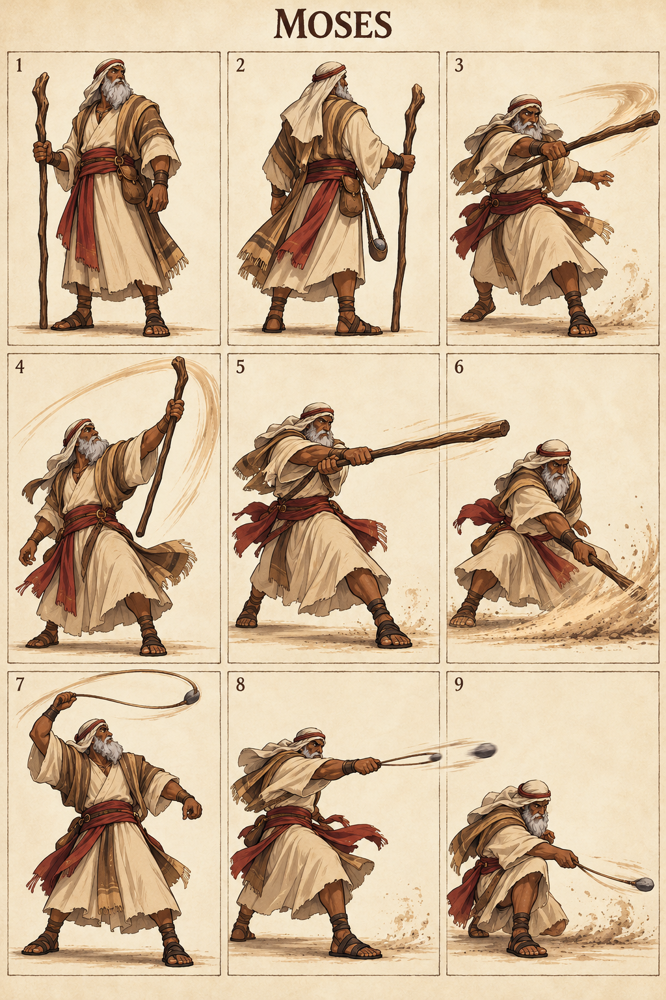

# Moses — The Wilderness Leader

## Character build prompt

Implement Moses as a complete playable Covenant Clash fighter. Use the master, shared physics, weapon kits and this signature specification. Finish moves and animations as independent clips; do not turn the reference sheet into a nine-frame attack. No attack is a documented biblical action unless expressly noted as context.

## Bible background

**References:** Exodus 3:1–12; 14:13–31; 17:8–13; Numbers 20:7–12. Led Israel from Egypt by God’s command. The game does not turn the plagues, Red Sea, commandments or miracles into repeatable offensive spells; sling combat is explicitly fictional. The arena moves below are invented for this fictional sporting game. Story context is optional and separate from controls. No victory/defeat measures spiritual worth.

## Identity and visual lock

Elderly adult with deep warm-brown complexion, thick silver beard, sturdy build, sandstone robe split for safe movement, brick-red waist wrap, plain headcloth and worn wooden shepherd staff; woven practice sling.

**Neutral posture:** Staff planted beside his foot, upright composed posture; deliberate grounded motion without frailty caricature.

**Stats:** Power 4, Guard 7, Speed 4; total 15. Common capsule 40×74 units. Stats alter damage/knockback/run cap only, never frame timing. **Weakness:** Slow to reposition and vulnerable during ranged windup.

## Generated sheet

Read panels left-to-right, top-to-bottom. They are illustrative key poses, not final runtime frames.

| Panel | Meaning |
|---|---|
| 1 | Front/idle identity |
| 2 | Back/turnaround |
| 3 | Example ordinary Light attack; family file supplies full kit |
| 4 | Staff N: Wilderness Rise |
| 5 | Staff S: Leader’s Reach |
| 6 | Staff D: Desert Boundary |
| 7 | Sling N: Ridge Stone |
| 8 | Sling S: Trail Marker |
| 9 | Sling D: Low Passage |

## Complete shared attacks

- [Staff full kit](../../02_Gameplay/Weapons/staff_complete_kit.md): nlight, slight, dlight, nair, sair, dair, recovery and ground pound.
- [Sling full kit](../../02_Gameplay/Weapons/sling_complete_kit.md): nlight, slight, dlight, nair, sair, dair, recovery and ground pound.
- [Unarmed complete kit](../../02_Gameplay/Weapons/unarmed_complete_kit.md): eight basics plus three grounded heavies.

Weapon A/B alternate on neutral pickup. Ordinary weapon lights/aerials use their family rules. The fighter-specific signatures below replace grounded weapon Heavy. All attack controls are semantic, so N/S/D mean neutral/side/down direction with Heavy on any selected input device.

## Six signatures

S/A/R = startup/active/recovery ticks at 60 Hz, before optional charge hold. Base damage precedes Power scaling. One hit per target per instance.

| Art panel | Weapon | Input | Signature | S/A/R | Damage | Role |
|---|---|---|---|---|---|---|
| 4 | Staff | N+Heavy | Wilderness Rise | 22/6/31 | 26 | anti-air control |
| 5 | Staff | S+Heavy | Leader’s Reach | 25/6/34 | 28 | long punish |
| 6 | Staff | D+Heavy | Desert Boundary | 27/6/35 | 27 | ground control |
| 7 | Sling | N+Heavy | Ridge Stone | 23/5/32 | 25 | ranged anti-air |
| 8 | Sling | S+Heavy | Trail Marker | 26/5/35 | 27 | ranged finisher |
| 9 | Sling | D+Heavy | Low Passage | 28/5/36 | 26 | low lane denial |

### 1. Wilderness Rise — staff N

**What it looks like:** Moses moves a plain staff from planted rest into a deliberate upward sweep; sleeves pull back around his forearms.

**Timeline:** ticks 0–21 prepare; 22–27 active; 28–58 recover. Hold grounded Heavy extends the anticipation by at most 36 ticks, with no free invulnerability. Aerial use needs the valid neutral-dodge cancel; ordinary airborne Heavy remains the family recovery/ground-pound.

**Simulation:** base damage 26, hitstun 22 ticks, base force 1280 Q/tick, growth 10 Q per whole damage unit, launch 90° with facing mirror. No scripted body translation; the attack reaches through the prop/limb animation only. Initial local contact rectangle: [-33, 40, 65, 150] design units; refine the prototype envelope against final animation.

**Purpose and counterplay:** Anti-Air Control. Leave the contact region before active frames, then punish the exposed ending pose. No armor protects this move. Whiff recovery is paid in full; no signature chain-cancel. Test opponents at low/high damage, edge spacing, mirrored facing and near a platform side.

**Animator instruction:** show one readable anticipation, one distinct contact silhouette and one vulnerable finish. Keep face, costume and foot pivot consistent with panels 1–2. Panel 4 illustrates the intended contact, not the whole animation or an exact trajectory.

### 2. Leader’s Reach — staff S

**What it looks like:** Moses steps firmly and strikes forward with the staff’s long end at chest height.

**Timeline:** ticks 0–24 prepare; 25–30 active; 31–64 recover. Hold grounded Heavy extends the anticipation by at most 36 ticks, with no free invulnerability. Aerial use needs the valid neutral-dodge cancel; ordinary airborne Heavy remains the family recovery/ground-pound.

**Simulation:** base damage 28, hitstun 22 ticks, base force 1280 Q/tick, growth 10 Q per whole damage unit, launch 22° with facing mirror. No scripted body translation; the attack reaches through the prop/limb animation only. Initial local contact rectangle: [24, 24, 155, 60] design units; refine the prototype envelope against final animation.

**Purpose and counterplay:** Long Punish. Leave the contact region before active frames, then punish the exposed ending pose. No armor protects this move. Whiff recovery is paid in full; no signature chain-cancel. Test opponents at low/high damage, edge spacing, mirrored facing and near a platform side.

**Animator instruction:** show one readable anticipation, one distinct contact silhouette and one vulnerable finish. Keep face, costume and foot pivot consistent with panels 1–2. Panel 5 illustrates the intended contact, not the whole animation or an exact trajectory.

### 3. Desert Boundary — staff D

**What it looks like:** Moses lowers into a braced stance and sweeps the staff across a low frontward lane, with ordinary sand dust.

**Timeline:** ticks 0–26 prepare; 27–32 active; 33–67 recover. Hold grounded Heavy extends the anticipation by at most 36 ticks, with no free invulnerability. Aerial use needs the valid neutral-dodge cancel; ordinary airborne Heavy remains the family recovery/ground-pound.

**Simulation:** base damage 27, hitstun 22 ticks, base force 1280 Q/tick, growth 10 Q per whole damage unit, launch 22° with facing mirror. No scripted body translation; the attack reaches through the prop/limb animation only. Initial local contact rectangle: [20, 0, 145, 18] design units; refine the prototype envelope against final animation.

**Purpose and counterplay:** Ground Control. Leave the contact region before active frames, then punish the exposed ending pose. No armor protects this move. Whiff recovery is paid in full; no signature chain-cancel. Test opponents at low/high damage, edge spacing, mirrored facing and near a platform side.

**Animator instruction:** show one readable anticipation, one distinct contact silhouette and one vulnerable finish. Keep face, costume and foot pivot consistent with panels 1–2. Panel 6 illustrates the intended contact, not the whole animation or an exact trajectory.

### 4. Ridge Stone — sling N

**What it looks like:** Moses makes one controlled overhead sling rotation and releases a training stone upward.

**Timeline:** ticks 0–22 prepare; 23–27 active; 28–59 recover. Hold grounded Heavy extends the anticipation by at most 36 ticks, with no free invulnerability. Aerial use needs the valid neutral-dodge cancel; ordinary airborne Heavy remains the family recovery/ground-pound.

**Simulation:** base damage 25, hitstun 22 ticks, base force 1280 Q/tick, growth 10 Q per whole damage unit, launch 67° with facing mirror. No scripted body translation; the attack reaches through the prop/limb animation only. Release one 14×14-unit projectile at local origin [28, 68], speed 14 units/tick and 60-tick lifetime, travel angle 67°; paint trails without creating extra hitboxes.

**Purpose and counterplay:** Ranged Anti-Air. Jump or dodge the finite projectile lane, then approach during the recovery. There is no homing or reflection. Whiff recovery is paid in full; no signature chain-cancel. Test opponents at low/high damage, edge spacing, mirrored facing and near a platform side.

**Animator instruction:** show one readable anticipation, one distinct contact silhouette and one vulnerable finish. Keep face, costume and foot pivot consistent with panels 1–2. Panel 7 illustrates the intended contact, not the whole animation or an exact trajectory.

### 5. Trail Marker — sling S

**What it looks like:** Moses turns his upper body and releases one stone through a horizontal front lane.

**Timeline:** ticks 0–25 prepare; 26–30 active; 31–65 recover. Hold grounded Heavy extends the anticipation by at most 36 ticks, with no free invulnerability. Aerial use needs the valid neutral-dodge cancel; ordinary airborne Heavy remains the family recovery/ground-pound.

**Simulation:** base damage 27, hitstun 22 ticks, base force 1280 Q/tick, growth 10 Q per whole damage unit, launch 22° with facing mirror. No scripted body translation; the attack reaches through the prop/limb animation only. Release one 14×14-unit projectile at local origin [28, 45], speed 14 units/tick and 60-tick lifetime, travel angle 0°; paint trails without creating extra hitboxes.

**Purpose and counterplay:** Ranged Finisher. Jump or dodge the finite projectile lane, then approach during the recovery. There is no homing or reflection. Whiff recovery is paid in full; no signature chain-cancel. Test opponents at low/high damage, edge spacing, mirrored facing and near a platform side.

**Animator instruction:** show one readable anticipation, one distinct contact silhouette and one vulnerable finish. Keep face, costume and foot pivot consistent with panels 1–2. Panel 8 illustrates the intended contact, not the whole animation or an exact trajectory.

### 6. Low Passage — sling D

**What it looks like:** Moses bends at the knee and releases a low stone across the training floor.

**Timeline:** ticks 0–27 prepare; 28–32 active; 33–68 recover. Hold grounded Heavy extends the anticipation by at most 36 ticks, with no free invulnerability. Aerial use needs the valid neutral-dodge cancel; ordinary airborne Heavy remains the family recovery/ground-pound.

**Simulation:** base damage 26, hitstun 22 ticks, base force 1280 Q/tick, growth 10 Q per whole damage unit, launch 22° with facing mirror. No scripted body translation; the attack reaches through the prop/limb animation only. Release one 14×14-unit projectile at local origin [28, 12], speed 14 units/tick and 60-tick lifetime, travel angle 0°; paint trails without creating extra hitboxes.

**Purpose and counterplay:** Low Lane Denial. Jump or dodge the finite projectile lane, then approach during the recovery. There is no homing or reflection. Whiff recovery is paid in full; no signature chain-cancel. Test opponents at low/high damage, edge spacing, mirrored facing and near a platform side.

**Animator instruction:** show one readable anticipation, one distinct contact silhouette and one vulnerable finish. Keep face, costume and foot pivot consistent with panels 1–2. Panel 9 illustrates the intended contact, not the whole animation or an exact trajectory.

## Gameplay personality

Use the strengths shown by the weapon pairing while preserving the stated weakness. Start practice with movement and family lights; use signatures as deliberate reads or punishers. Recovery and dodging use the exact shared resource rules. No character-exclusive miracle, invulnerability, teammate buff or hidden auto-aim. Cosmetics must keep the weapon and player marker readable.

## Required character output and verification

Portrait, selection icon, model/turnaround, weapon A/B/unarmed locomotion, defense/item animations, all family attacks and six signature timelines, atlas/rig metadata, valid attack IDs and replay tests. Check both facing directions, every input method, idle-to-attack transition, getting hit mid-charge, weapon throw/pickup and ring-out/respawn. Review face, hands, grip, costume continuity, pivot and tiny-screen silhouette. Final asset readiness must be recorded; the supplied PNG is concept art.

## ELI5

Moses has two sets of tools. Pick up a tool, then use direction plus Light or Heavy. Big moves hit harder but leave a longer opening if you miss. Good timing beats button spam.
