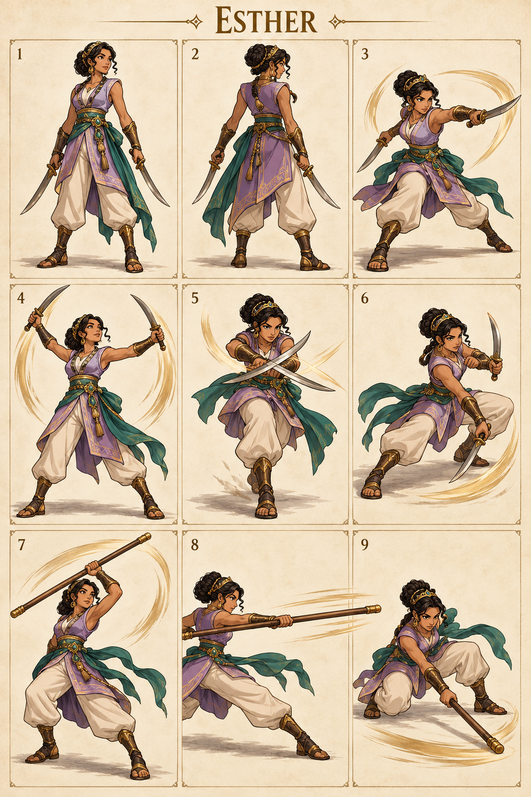

# Esther — The Courageous Queen

## Character build prompt

Implement Esther as a complete playable Covenant Clash fighter. Use the master, shared physics, weapon kits and this signature specification. Finish moves and animations as independent clips; do not turn the reference sheet into a nine-frame attack. No attack is a documented biblical action unless expressly noted as context.

## Bible background

**References:** Esther 4:13–16; 5:1–8; 7:1–6. A Jewish queen who risked her position and life for her people. Combat is a fictional arena interpretation; it must not be presented as an event in Esther. The arena moves below are invented for this fictional sporting game. Story context is optional and separate from controls. No victory/defeat measures spiritual worth.

## Identity and visual lock

Adult woman with warm medium-brown skin and dark braided hair secured in a bun, lilac cropped outer tunic over cream trousers, restrained Persian-inspired gold hairpiece and emerald waist sash; short practice blades and slender wooden staff.

**Neutral posture:** Poised side stance, blades lowered, balanced feet; graceful athletic rather than sexualized design.

**Stats:** Power 3, Guard 4, Speed 8; total 15. Common capsule 40×74 units. Stats alter damage/knockback/run cap only, never frame timing. **Weakness:** Low damage and short blade reach; must win spacing repeatedly.

## Generated sheet

Read panels left-to-right, top-to-bottom. They are illustrative key poses, not final runtime frames.

| Panel | Meaning |
|---|---|
| 1 | Front/idle identity |
| 2 | Back/turnaround |
| 3 | Example ordinary Light attack; family file supplies full kit |
| 4 | Blades N: Courage Lift |
| 5 | Blades S: Bold Approach |
| 6 | Blades D: Measured Retreat |
| 7 | Staff N: Royal Ascend |
| 8 | Staff S: Courtline Reach |
| 9 | Staff D: Scepter Sweep |

## Complete shared attacks

- [Blades full kit](../../02_Gameplay/Weapons/blades_complete_kit.md): nlight, slight, dlight, nair, sair, dair, recovery and ground pound.
- [Staff full kit](../../02_Gameplay/Weapons/staff_complete_kit.md): nlight, slight, dlight, nair, sair, dair, recovery and ground pound.
- [Unarmed complete kit](../../02_Gameplay/Weapons/unarmed_complete_kit.md): eight basics plus three grounded heavies.

Weapon A/B alternate on neutral pickup. Ordinary weapon lights/aerials use their family rules. The fighter-specific signatures below replace grounded weapon Heavy. All attack controls are semantic, so N/S/D mean neutral/side/down direction with Heavy on any selected input device.

## Six signatures

S/A/R = startup/active/recovery ticks at 60 Hz, before optional charge hold. Base damage precedes Power scaling. One hit per target per instance.

| Art panel | Weapon | Input | Signature | S/A/R | Damage | Role |
|---|---|---|---|---|---|---|
| 4 | Blades | N+Heavy | Courage Lift | 16/5/24 | 22 | close anti-air |
| 5 | Blades | S+Heavy | Bold Approach | 20/5/28 | 24 | fast punish |
| 6 | Blades | D+Heavy | Measured Retreat | 23/5/30 | 23 | retreat punish |
| 7 | Staff | N+Heavy | Royal Ascend | 19/5/26 | 23 | anti-air spacing |
| 8 | Staff | S+Heavy | Courtline Reach | 23/5/30 | 25 | lane finisher |
| 9 | Staff | D+Heavy | Scepter Sweep | 25/5/32 | 24 | ground control |

### 1. Courage Lift — blades N

**What it looks like:** Esther opens crossed practice blades into a precise upward fan, chin lifted and feet firmly planted.

**Timeline:** ticks 0–15 prepare; 16–20 active; 21–44 recover. Hold grounded Heavy extends the anticipation by at most 36 ticks, with no free invulnerability. Aerial use needs the valid neutral-dodge cancel; ordinary airborne Heavy remains the family recovery/ground-pound.

**Simulation:** base damage 22, hitstun 22 ticks, base force 1280 Q/tick, growth 10 Q per whole damage unit, launch 90° with facing mirror. No scripted body translation; the attack reaches through the prop/limb animation only. Initial local contact rectangle: [-23, 40, 45, 115] design units; refine the prototype envelope against final animation.

**Purpose and counterplay:** Close Anti-Air. Leave the contact region before active frames, then punish the exposed ending pose. No armor protects this move. Whiff recovery is paid in full; no signature chain-cancel. Test opponents at low/high damage, edge spacing, mirrored facing and near a platform side.

**Animator instruction:** show one readable anticipation, one distinct contact silhouette and one vulnerable finish. Keep face, costume and foot pivot consistent with panels 1–2. Panel 4 illustrates the intended contact, not the whole animation or an exact trajectory.

### 2. Bold Approach — blades S

**What it looks like:** Esther takes one quick advancing step and makes a single crossed blade strike in front.

**Timeline:** ticks 0–19 prepare; 20–24 active; 25–52 recover. Hold grounded Heavy extends the anticipation by at most 36 ticks, with no free invulnerability. Aerial use needs the valid neutral-dodge cancel; ordinary airborne Heavy remains the family recovery/ground-pound.

**Simulation:** base damage 24, hitstun 22 ticks, base force 1280 Q/tick, growth 10 Q per whole damage unit, launch 22° with facing mirror. The fighter advances 6 design units per active tick, stopped by solid collision. Initial local contact rectangle: [24, 24, 105, 55] design units; refine the prototype envelope against final animation.

**Purpose and counterplay:** Fast Punish. Leave the contact region before active frames, then punish the exposed ending pose. No armor protects this move. Whiff recovery is paid in full; no signature chain-cancel. Test opponents at low/high damage, edge spacing, mirrored facing and near a platform side.

**Animator instruction:** show one readable anticipation, one distinct contact silhouette and one vulnerable finish. Keep face, costume and foot pivot consistent with panels 1–2. Panel 5 illustrates the intended contact, not the whole animation or an exact trajectory.

### 3. Measured Retreat — blades D

**What it looks like:** Esther shifts backward during the windup, then sweeps one blade low in front while the other guards her body.

**Timeline:** ticks 0–22 prepare; 23–27 active; 28–57 recover. Hold grounded Heavy extends the anticipation by at most 36 ticks, with no free invulnerability. Aerial use needs the valid neutral-dodge cancel; ordinary airborne Heavy remains the family recovery/ground-pound.

**Simulation:** base damage 23, hitstun 22 ticks, base force 1280 Q/tick, growth 10 Q per whole damage unit, launch 22° with facing mirror. The fighter retreats 4 units per tick during the final 6 startup ticks, stopped by solid geometry. Initial local contact rectangle: [20, 0, 100, 18] design units; refine the prototype envelope against final animation.

**Purpose and counterplay:** Retreat Punish. Leave the contact region before active frames, then punish the exposed ending pose. No armor protects this move. Whiff recovery is paid in full; no signature chain-cancel. Test opponents at low/high damage, edge spacing, mirrored facing and near a platform side.

**Animator instruction:** show one readable anticipation, one distinct contact silhouette and one vulnerable finish. Keep face, costume and foot pivot consistent with panels 1–2. Panel 6 illustrates the intended contact, not the whole animation or an exact trajectory.

### 4. Royal Ascend — staff N

**What it looks like:** Esther rotates a slender wooden staff upward in a clean diagonal arc; sash echoes the movement.

**Timeline:** ticks 0–18 prepare; 19–23 active; 24–49 recover. Hold grounded Heavy extends the anticipation by at most 36 ticks, with no free invulnerability. Aerial use needs the valid neutral-dodge cancel; ordinary airborne Heavy remains the family recovery/ground-pound.

**Simulation:** base damage 23, hitstun 22 ticks, base force 1280 Q/tick, growth 10 Q per whole damage unit, launch 67° with facing mirror. No scripted body translation; the attack reaches through the prop/limb animation only. Initial local contact rectangle: [-35, 40, 70, 140] design units; refine the prototype envelope against final animation.

**Purpose and counterplay:** Anti-Air Spacing. Leave the contact region before active frames, then punish the exposed ending pose. No armor protects this move. Whiff recovery is paid in full; no signature chain-cancel. Test opponents at low/high damage, edge spacing, mirrored facing and near a platform side.

**Animator instruction:** show one readable anticipation, one distinct contact silhouette and one vulnerable finish. Keep face, costume and foot pivot consistent with panels 1–2. Panel 7 illustrates the intended contact, not the whole animation or an exact trajectory.

### 5. Courtline Reach — staff S

**What it looks like:** Esther steps laterally and extends the staff in one sharp horizontal strike.

**Timeline:** ticks 0–22 prepare; 23–27 active; 28–57 recover. Hold grounded Heavy extends the anticipation by at most 36 ticks, with no free invulnerability. Aerial use needs the valid neutral-dodge cancel; ordinary airborne Heavy remains the family recovery/ground-pound.

**Simulation:** base damage 25, hitstun 22 ticks, base force 1280 Q/tick, growth 10 Q per whole damage unit, launch 22° with facing mirror. No scripted body translation; the attack reaches through the prop/limb animation only. Initial local contact rectangle: [24, 24, 145, 60] design units; refine the prototype envelope against final animation.

**Purpose and counterplay:** Lane Finisher. Leave the contact region before active frames, then punish the exposed ending pose. No armor protects this move. Whiff recovery is paid in full; no signature chain-cancel. Test opponents at low/high damage, edge spacing, mirrored facing and near a platform side.

**Animator instruction:** show one readable anticipation, one distinct contact silhouette and one vulnerable finish. Keep face, costume and foot pivot consistent with panels 1–2. Panel 8 illustrates the intended contact, not the whole animation or an exact trajectory.

### 6. Scepter Sweep — staff D

**What it looks like:** Esther bends to a low stable stance and draws the staff’s far end across the front ground lane.

**Timeline:** ticks 0–24 prepare; 25–29 active; 30–61 recover. Hold grounded Heavy extends the anticipation by at most 36 ticks, with no free invulnerability. Aerial use needs the valid neutral-dodge cancel; ordinary airborne Heavy remains the family recovery/ground-pound.

**Simulation:** base damage 24, hitstun 22 ticks, base force 1280 Q/tick, growth 10 Q per whole damage unit, launch 22° with facing mirror. No scripted body translation; the attack reaches through the prop/limb animation only. Initial local contact rectangle: [20, 0, 140, 18] design units; refine the prototype envelope against final animation.

**Purpose and counterplay:** Ground Control. Leave the contact region before active frames, then punish the exposed ending pose. No armor protects this move. Whiff recovery is paid in full; no signature chain-cancel. Test opponents at low/high damage, edge spacing, mirrored facing and near a platform side.

**Animator instruction:** show one readable anticipation, one distinct contact silhouette and one vulnerable finish. Keep face, costume and foot pivot consistent with panels 1–2. Panel 9 illustrates the intended contact, not the whole animation or an exact trajectory.

## Gameplay personality

Use the strengths shown by the weapon pairing while preserving the stated weakness. Start practice with movement and family lights; use signatures as deliberate reads or punishers. Recovery and dodging use the exact shared resource rules. No character-exclusive miracle, invulnerability, teammate buff or hidden auto-aim. Cosmetics must keep the weapon and player marker readable.

## Required character output and verification

Portrait, selection icon, model/turnaround, weapon A/B/unarmed locomotion, defense/item animations, all family attacks and six signature timelines, atlas/rig metadata, valid attack IDs and replay tests. Check both facing directions, every input method, idle-to-attack transition, getting hit mid-charge, weapon throw/pickup and ring-out/respawn. Review face, hands, grip, costume continuity, pivot and tiny-screen silhouette. Final asset readiness must be recorded; the supplied PNG is concept art.

## ELI5

Esther has two sets of tools. Pick up a tool, then use direction plus Light or Heavy. Big moves hit harder but leave a longer opening if you miss. Good timing beats button spam.
