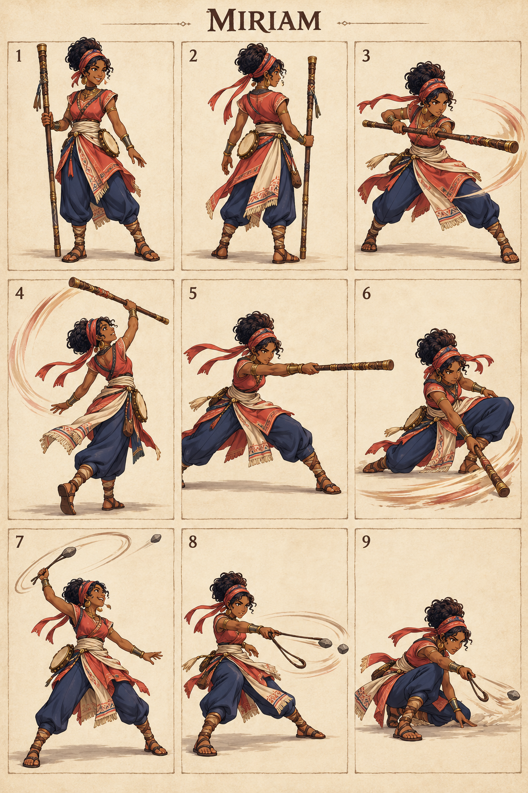

# Miriam — The Joyful Leader

## Character build prompt

Implement Miriam as a complete playable Covenant Clash fighter. Use the master, shared physics, weapon kits and this signature specification. Finish moves and animations as independent clips; do not turn the reference sheet into a nine-frame attack. No attack is a documented biblical action unless expressly noted as context.

## Bible background

**References:** Exodus 15:20–21; Numbers 12:1–15. A prophetess associated with celebration after the Exodus, with a later failure also recorded. Tambourine motifs and arena weapons are fictional; music never mind-controls opponents. The arena moves below are invented for this fictional sporting game. Story context is optional and separate from controls. No victory/defeat measures spiritual worth.

## Identity and visual lock

Adult woman with rich brown complexion, dark coiled hair in a secure high wrap, coral-red tunic, indigo trousers, cream woven waist sash and small tambourine secured at hip; decorated wooden staff and simple sling.

**Neutral posture:** Light rhythmic foot stance and bright alert expression; tambourine remains decorative, no musical shockwaves.

**Stats:** Power 3, Guard 6, Speed 6; total 15. Common capsule 40×74 units. Stats alter damage/knockback/run cap only, never frame timing. **Weakness:** Modest finisher strength; predictable long staff lanes.

## Generated sheet

Read panels left-to-right, top-to-bottom. They are illustrative key poses, not final runtime frames.

| Panel | Meaning |
|---|---|
| 1 | Front/idle identity |
| 2 | Back/turnaround |
| 3 | Example ordinary Light attack; family file supplies full kit |
| 4 | Staff N: Rhythm Rise |
| 5 | Staff S: Joyful Advance |
| 6 | Staff D: Steady Beat |
| 7 | Sling N: Morning Stone |
| 8 | Sling S: Riverbank Line |
| 9 | Sling D: Shoreline Skip |

## Complete shared attacks

- [Staff full kit](../../02_Gameplay/Weapons/staff_complete_kit.md): nlight, slight, dlight, nair, sair, dair, recovery and ground pound.
- [Sling full kit](../../02_Gameplay/Weapons/sling_complete_kit.md): nlight, slight, dlight, nair, sair, dair, recovery and ground pound.
- [Unarmed complete kit](../../02_Gameplay/Weapons/unarmed_complete_kit.md): eight basics plus three grounded heavies.

Weapon A/B alternate on neutral pickup. Ordinary weapon lights/aerials use their family rules. The fighter-specific signatures below replace grounded weapon Heavy. All attack controls are semantic, so N/S/D mean neutral/side/down direction with Heavy on any selected input device.

## Six signatures

S/A/R = startup/active/recovery ticks at 60 Hz, before optional charge hold. Base damage precedes Power scaling. One hit per target per instance.

| Art panel | Weapon | Input | Signature | S/A/R | Damage | Role |
|---|---|---|---|---|---|---|
| 4 | Staff | N+Heavy | Rhythm Rise | 18/5/25 | 23 | anti-air |
| 5 | Staff | S+Heavy | Joyful Advance | 22/5/29 | 25 | spacing punish |
| 6 | Staff | D+Heavy | Steady Beat | 24/6/31 | 24 | low control |
| 7 | Sling | N+Heavy | Morning Stone | 20/5/27 | 23 | ranged anti-air |
| 8 | Sling | S+Heavy | Riverbank Line | 24/5/31 | 25 | ranged punish |
| 9 | Sling | D+Heavy | Shoreline Skip | 26/5/33 | 24 | low projectile |

### 1. Rhythm Rise — staff N

**What it looks like:** Miriam rotates the staff upward with a light rear-foot pivot; sash and tied ribbon trail as painted motion accents.

**Timeline:** ticks 0–17 prepare; 18–22 active; 23–47 recover. Hold grounded Heavy extends the anticipation by at most 36 ticks, with no free invulnerability. Aerial use needs the valid neutral-dodge cancel; ordinary airborne Heavy remains the family recovery/ground-pound.

**Simulation:** base damage 23, hitstun 22 ticks, base force 1280 Q/tick, growth 10 Q per whole damage unit, launch 67° with facing mirror. No scripted body translation; the attack reaches through the prop/limb animation only. Initial local contact rectangle: [-35, 40, 70, 140] design units; refine the prototype envelope against final animation.

**Purpose and counterplay:** Anti-Air. Leave the contact region before active frames, then punish the exposed ending pose. No armor protects this move. Whiff recovery is paid in full; no signature chain-cancel. Test opponents at low/high damage, edge spacing, mirrored facing and near a platform side.

**Animator instruction:** show one readable anticipation, one distinct contact silhouette and one vulnerable finish. Keep face, costume and foot pivot consistent with panels 1–2. Panel 4 illustrates the intended contact, not the whole animation or an exact trajectory.

### 2. Joyful Advance — staff S

**What it looks like:** Miriam steps forward and extends the staff horizontally in one energetic strike.

**Timeline:** ticks 0–21 prepare; 22–26 active; 27–55 recover. Hold grounded Heavy extends the anticipation by at most 36 ticks, with no free invulnerability. Aerial use needs the valid neutral-dodge cancel; ordinary airborne Heavy remains the family recovery/ground-pound.

**Simulation:** base damage 25, hitstun 22 ticks, base force 1280 Q/tick, growth 10 Q per whole damage unit, launch 22° with facing mirror. No scripted body translation; the attack reaches through the prop/limb animation only. Initial local contact rectangle: [24, 24, 145, 60] design units; refine the prototype envelope against final animation.

**Purpose and counterplay:** Spacing Punish. Leave the contact region before active frames, then punish the exposed ending pose. No armor protects this move. Whiff recovery is paid in full; no signature chain-cancel. Test opponents at low/high damage, edge spacing, mirrored facing and near a platform side.

**Animator instruction:** show one readable anticipation, one distinct contact silhouette and one vulnerable finish. Keep face, costume and foot pivot consistent with panels 1–2. Panel 5 illustrates the intended contact, not the whole animation or an exact trajectory.

### 3. Steady Beat — staff D

**What it looks like:** Miriam bends one knee and sweeps the staff low across the front floor lane.

**Timeline:** ticks 0–23 prepare; 24–29 active; 30–60 recover. Hold grounded Heavy extends the anticipation by at most 36 ticks, with no free invulnerability. Aerial use needs the valid neutral-dodge cancel; ordinary airborne Heavy remains the family recovery/ground-pound.

**Simulation:** base damage 24, hitstun 22 ticks, base force 1280 Q/tick, growth 10 Q per whole damage unit, launch 22° with facing mirror. No scripted body translation; the attack reaches through the prop/limb animation only. Initial local contact rectangle: [20, 0, 140, 18] design units; refine the prototype envelope against final animation.

**Purpose and counterplay:** Low Control. Leave the contact region before active frames, then punish the exposed ending pose. No armor protects this move. Whiff recovery is paid in full; no signature chain-cancel. Test opponents at low/high damage, edge spacing, mirrored facing and near a platform side.

**Animator instruction:** show one readable anticipation, one distinct contact silhouette and one vulnerable finish. Keep face, costume and foot pivot consistent with panels 1–2. Panel 6 illustrates the intended contact, not the whole animation or an exact trajectory.

### 4. Morning Stone — sling N

**What it looks like:** Miriam makes a compact overhead sling rotation and releases one ordinary training stone upward.

**Timeline:** ticks 0–19 prepare; 20–24 active; 25–51 recover. Hold grounded Heavy extends the anticipation by at most 36 ticks, with no free invulnerability. Aerial use needs the valid neutral-dodge cancel; ordinary airborne Heavy remains the family recovery/ground-pound.

**Simulation:** base damage 23, hitstun 22 ticks, base force 1280 Q/tick, growth 10 Q per whole damage unit, launch 67° with facing mirror. No scripted body translation; the attack reaches through the prop/limb animation only. Release one 14×14-unit projectile at local origin [28, 68], speed 14 units/tick and 60-tick lifetime, travel angle 67°; paint trails without creating extra hitboxes.

**Purpose and counterplay:** Ranged Anti-Air. Jump or dodge the finite projectile lane, then approach during the recovery. There is no homing or reflection. Whiff recovery is paid in full; no signature chain-cancel. Test opponents at low/high damage, edge spacing, mirrored facing and near a platform side.

**Animator instruction:** show one readable anticipation, one distinct contact silhouette and one vulnerable finish. Keep face, costume and foot pivot consistent with panels 1–2. Panel 7 illustrates the intended contact, not the whole animation or an exact trajectory.

### 5. Riverbank Line — sling S

**What it looks like:** Miriam makes one lively waist-level sling rotation and sends a stone into the horizontal front lane.

**Timeline:** ticks 0–23 prepare; 24–28 active; 29–59 recover. Hold grounded Heavy extends the anticipation by at most 36 ticks, with no free invulnerability. Aerial use needs the valid neutral-dodge cancel; ordinary airborne Heavy remains the family recovery/ground-pound.

**Simulation:** base damage 25, hitstun 22 ticks, base force 1280 Q/tick, growth 10 Q per whole damage unit, launch 22° with facing mirror. No scripted body translation; the attack reaches through the prop/limb animation only. Release one 14×14-unit projectile at local origin [28, 45], speed 14 units/tick and 60-tick lifetime, travel angle 0°; paint trails without creating extra hitboxes.

**Purpose and counterplay:** Ranged Punish. Jump or dodge the finite projectile lane, then approach during the recovery. There is no homing or reflection. Whiff recovery is paid in full; no signature chain-cancel. Test opponents at low/high damage, edge spacing, mirrored facing and near a platform side.

**Animator instruction:** show one readable anticipation, one distinct contact silhouette and one vulnerable finish. Keep face, costume and foot pivot consistent with panels 1–2. Panel 8 illustrates the intended contact, not the whole animation or an exact trajectory.

### 6. Shoreline Skip — sling D

**What it looks like:** Miriam crouches and sends one stone along a low frontward path; no water effects or miracles.

**Timeline:** ticks 0–25 prepare; 26–30 active; 31–63 recover. Hold grounded Heavy extends the anticipation by at most 36 ticks, with no free invulnerability. Aerial use needs the valid neutral-dodge cancel; ordinary airborne Heavy remains the family recovery/ground-pound.

**Simulation:** base damage 24, hitstun 22 ticks, base force 1280 Q/tick, growth 10 Q per whole damage unit, launch 22° with facing mirror. No scripted body translation; the attack reaches through the prop/limb animation only. Release one 14×14-unit projectile at local origin [28, 12], speed 14 units/tick and 60-tick lifetime, travel angle 0°; paint trails without creating extra hitboxes.

**Purpose and counterplay:** Low Projectile. Jump or dodge the finite projectile lane, then approach during the recovery. There is no homing or reflection. Whiff recovery is paid in full; no signature chain-cancel. Test opponents at low/high damage, edge spacing, mirrored facing and near a platform side.

**Animator instruction:** show one readable anticipation, one distinct contact silhouette and one vulnerable finish. Keep face, costume and foot pivot consistent with panels 1–2. Panel 9 illustrates the intended contact, not the whole animation or an exact trajectory.

## Gameplay personality

Use the strengths shown by the weapon pairing while preserving the stated weakness. Start practice with movement and family lights; use signatures as deliberate reads or punishers. Recovery and dodging use the exact shared resource rules. No character-exclusive miracle, invulnerability, teammate buff or hidden auto-aim. Cosmetics must keep the weapon and player marker readable.

## Required character output and verification

Portrait, selection icon, model/turnaround, weapon A/B/unarmed locomotion, defense/item animations, all family attacks and six signature timelines, atlas/rig metadata, valid attack IDs and replay tests. Check both facing directions, every input method, idle-to-attack transition, getting hit mid-charge, weapon throw/pickup and ring-out/respawn. Review face, hands, grip, costume continuity, pivot and tiny-screen silhouette. Final asset readiness must be recorded; the supplied PNG is concept art.

## ELI5

Miriam has two sets of tools. Pick up a tool, then use direction plus Light or Heavy. Big moves hit harder but leave a longer opening if you miss. Good timing beats button spam.
