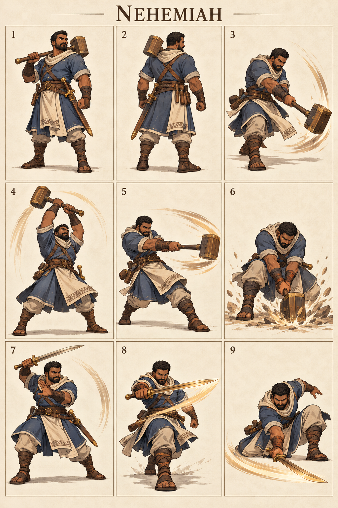

# Nehemiah — The Watchful Builder

## Character build prompt

Implement Nehemiah as a complete playable Covenant Clash fighter. Use the master, shared physics, weapon kits and this signature specification. Finish moves and animations as independent clips; do not turn the reference sheet into a nine-frame attack. No attack is a documented biblical action unless expressly noted as context.

## Bible background

**References:** Nehemiah 2:17–18; 4:16–18; 6:15–16. Organized the rebuilding of Jerusalem’s wall. Nehemiah 4 describes armed work; his mallet and moves are practical fictional arena interpretations. The arena moves below are invented for this fictional sporting game. Story context is optional and separate from controls. No victory/defeat measures spiritual worth.

## Identity and visual lock

Stocky adult man, medium-deep brown skin, cropped dark hair and close beard, slate-blue worker tunic, cream apron panels, leather tool belt, bronze sword and square wooden builder’s mallet; strong blocky silhouette.

**Neutral posture:** Mallet across shoulder, sword secured, firm workman stance; grounded efficient weight transfers.

**Stats:** Power 6, Guard 7, Speed 2; total 15. Common capsule 40×74 units. Stats alter damage/knockback/run cap only, never frame timing. **Weakness:** Very slow chase and pronounced recovery; no shield or construction invulnerability.

## Generated sheet

Read panels left-to-right, top-to-bottom. They are illustrative key poses, not final runtime frames.

| Panel | Meaning |
|---|---|
| 1 | Front/idle identity |
| 2 | Back/turnaround |
| 3 | Example ordinary Light attack; family file supplies full kit |
| 4 | Hammer N: Builder’s Lift |
| 5 | Hammer S: Foundation Strike |
| 6 | Hammer D: Wall Footing |
| 7 | Sword N: Watchman Rise |
| 8 | Sword S: Wallline Guard |
| 9 | Sword D: Gate Sweep |

## Complete shared attacks

- [Hammer full kit](../../02_Gameplay/Weapons/hammer_complete_kit.md): nlight, slight, dlight, nair, sair, dair, recovery and ground pound.
- [Sword full kit](../../02_Gameplay/Weapons/sword_complete_kit.md): nlight, slight, dlight, nair, sair, dair, recovery and ground pound.
- [Unarmed complete kit](../../02_Gameplay/Weapons/unarmed_complete_kit.md): eight basics plus three grounded heavies.

Weapon A/B alternate on neutral pickup. Ordinary weapon lights/aerials use their family rules. The fighter-specific signatures below replace grounded weapon Heavy. All attack controls are semantic, so N/S/D mean neutral/side/down direction with Heavy on any selected input device.

## Six signatures

S/A/R = startup/active/recovery ticks at 60 Hz, before optional charge hold. Base damage precedes Power scaling. One hit per target per instance.

| Art panel | Weapon | Input | Signature | S/A/R | Damage | Role |
|---|---|---|---|---|---|---|
| 4 | Hammer | N+Heavy | Builder’s Lift | 24/6/33 | 28 | heavy anti-air |
| 5 | Hammer | S+Heavy | Foundation Strike | 28/6/37 | 31 | heavy finisher |
| 6 | Hammer | D+Heavy | Wall Footing | 30/7/39 | 29 | ground denial |
| 7 | Sword | N+Heavy | Watchman Rise | 21/5/30 | 26 | close anti-air |
| 8 | Sword | S+Heavy | Wallline Guard | 25/5/34 | 29 | lane punish |
| 9 | Sword | D+Heavy | Gate Sweep | 27/6/36 | 27 | low finisher |

### 1. Builder’s Lift — hammer N

**What it looks like:** Nehemiah lifts a square wooden mallet from hip to overhead in a firm upward arc.

**Timeline:** ticks 0–23 prepare; 24–29 active; 30–62 recover. Hold grounded Heavy extends the anticipation by at most 36 ticks, with no free invulnerability. Aerial use needs the valid neutral-dodge cancel; ordinary airborne Heavy remains the family recovery/ground-pound.

**Simulation:** base damage 28, hitstun 22 ticks, base force 1280 Q/tick, growth 10 Q per whole damage unit, launch 90° with facing mirror. No scripted body translation; the attack reaches through the prop/limb animation only. Initial local contact rectangle: [-30, 40, 60, 145] design units; refine the prototype envelope against final animation.

**Purpose and counterplay:** Heavy Anti-Air. Leave the contact region before active frames, then punish the exposed ending pose. No armor protects this move. Whiff recovery is paid in full; no signature chain-cancel. Test opponents at low/high damage, edge spacing, mirrored facing and near a platform side.

**Animator instruction:** show one readable anticipation, one distinct contact silhouette and one vulnerable finish. Keep face, costume and foot pivot consistent with panels 1–2. Panel 4 illustrates the intended contact, not the whole animation or an exact trajectory.

### 2. Foundation Strike — hammer S

**What it looks like:** Nehemiah plants his rear foot and rotates a mallet strike horizontally through the front lane.

**Timeline:** ticks 0–27 prepare; 28–33 active; 34–70 recover. Hold grounded Heavy extends the anticipation by at most 36 ticks, with no free invulnerability. Aerial use needs the valid neutral-dodge cancel; ordinary airborne Heavy remains the family recovery/ground-pound.

**Simulation:** base damage 31, hitstun 22 ticks, base force 1280 Q/tick, growth 10 Q per whole damage unit, launch 22° with facing mirror. No scripted body translation; the attack reaches through the prop/limb animation only. Initial local contact rectangle: [24, 24, 135, 65] design units; refine the prototype envelope against final animation.

**Purpose and counterplay:** Heavy Finisher. Leave the contact region before active frames, then punish the exposed ending pose. No armor protects this move. Whiff recovery is paid in full; no signature chain-cancel. Test opponents at low/high damage, edge spacing, mirrored facing and near a platform side.

**Animator instruction:** show one readable anticipation, one distinct contact silhouette and one vulnerable finish. Keep face, costume and foot pivot consistent with panels 1–2. Panel 5 illustrates the intended contact, not the whole animation or an exact trajectory.

### 3. Wall Footing — hammer D

**What it looks like:** Nehemiah drops into a wide braced stance and strikes the floor ahead with the mallet; dust only.

**Timeline:** ticks 0–29 prepare; 30–36 active; 37–75 recover. Hold grounded Heavy extends the anticipation by at most 36 ticks, with no free invulnerability. Aerial use needs the valid neutral-dodge cancel; ordinary airborne Heavy remains the family recovery/ground-pound.

**Simulation:** base damage 29, hitstun 22 ticks, base force 1280 Q/tick, growth 10 Q per whole damage unit, launch 45° with facing mirror. No scripted body translation; the attack reaches through the prop/limb animation only. Initial local contact rectangle: [20, 0, 120, 18] design units; refine the prototype envelope against final animation.

**Purpose and counterplay:** Ground Denial. Leave the contact region before active frames, then punish the exposed ending pose. No armor protects this move. Whiff recovery is paid in full; no signature chain-cancel. Test opponents at low/high damage, edge spacing, mirrored facing and near a platform side.

**Animator instruction:** show one readable anticipation, one distinct contact silhouette and one vulnerable finish. Keep face, costume and foot pivot consistent with panels 1–2. Panel 6 illustrates the intended contact, not the whole animation or an exact trajectory.

### 4. Watchman Rise — sword N

**What it looks like:** Nehemiah lifts his sword in a guarded rising cut while his free forearm protects his chest.

**Timeline:** ticks 0–20 prepare; 21–25 active; 26–55 recover. Hold grounded Heavy extends the anticipation by at most 36 ticks, with no free invulnerability. Aerial use needs the valid neutral-dodge cancel; ordinary airborne Heavy remains the family recovery/ground-pound.

**Simulation:** base damage 26, hitstun 22 ticks, base force 1280 Q/tick, growth 10 Q per whole damage unit, launch 67° with facing mirror. No scripted body translation; the attack reaches through the prop/limb animation only. Initial local contact rectangle: [-30, 40, 60, 125] design units; refine the prototype envelope against final animation.

**Purpose and counterplay:** Close Anti-Air. Leave the contact region before active frames, then punish the exposed ending pose. No armor protects this move. Whiff recovery is paid in full; no signature chain-cancel. Test opponents at low/high damage, edge spacing, mirrored facing and near a platform side.

**Animator instruction:** show one readable anticipation, one distinct contact silhouette and one vulnerable finish. Keep face, costume and foot pivot consistent with panels 1–2. Panel 7 illustrates the intended contact, not the whole animation or an exact trajectory.

### 5. Wallline Guard — sword S

**What it looks like:** Nehemiah takes one solid forward step and delivers a single horizontal sword cut.

**Timeline:** ticks 0–24 prepare; 25–29 active; 30–63 recover. Hold grounded Heavy extends the anticipation by at most 36 ticks, with no free invulnerability. Aerial use needs the valid neutral-dodge cancel; ordinary airborne Heavy remains the family recovery/ground-pound.

**Simulation:** base damage 29, hitstun 22 ticks, base force 1280 Q/tick, growth 10 Q per whole damage unit, launch 22° with facing mirror. The fighter advances 6 design units per active tick, stopped by solid collision. Initial local contact rectangle: [24, 24, 120, 55] design units; refine the prototype envelope against final animation.

**Purpose and counterplay:** Lane Punish. Leave the contact region before active frames, then punish the exposed ending pose. No armor protects this move. Whiff recovery is paid in full; no signature chain-cancel. Test opponents at low/high damage, edge spacing, mirrored facing and near a platform side.

**Animator instruction:** show one readable anticipation, one distinct contact silhouette and one vulnerable finish. Keep face, costume and foot pivot consistent with panels 1–2. Panel 8 illustrates the intended contact, not the whole animation or an exact trajectory.

### 6. Gate Sweep — sword D

**What it looks like:** Nehemiah lowers one knee and makes a low front-facing sword sweep with a clear ending pose.

**Timeline:** ticks 0–26 prepare; 27–32 active; 33–68 recover. Hold grounded Heavy extends the anticipation by at most 36 ticks, with no free invulnerability. Aerial use needs the valid neutral-dodge cancel; ordinary airborne Heavy remains the family recovery/ground-pound.

**Simulation:** base damage 27, hitstun 22 ticks, base force 1280 Q/tick, growth 10 Q per whole damage unit, launch 22° with facing mirror. No scripted body translation; the attack reaches through the prop/limb animation only. Initial local contact rectangle: [20, 0, 115, 18] design units; refine the prototype envelope against final animation.

**Purpose and counterplay:** Low Finisher. Leave the contact region before active frames, then punish the exposed ending pose. No armor protects this move. Whiff recovery is paid in full; no signature chain-cancel. Test opponents at low/high damage, edge spacing, mirrored facing and near a platform side.

**Animator instruction:** show one readable anticipation, one distinct contact silhouette and one vulnerable finish. Keep face, costume and foot pivot consistent with panels 1–2. Panel 9 illustrates the intended contact, not the whole animation or an exact trajectory.

## Gameplay personality

Use the strengths shown by the weapon pairing while preserving the stated weakness. Start practice with movement and family lights; use signatures as deliberate reads or punishers. Recovery and dodging use the exact shared resource rules. No character-exclusive miracle, invulnerability, teammate buff or hidden auto-aim. Cosmetics must keep the weapon and player marker readable.

## Required character output and verification

Portrait, selection icon, model/turnaround, weapon A/B/unarmed locomotion, defense/item animations, all family attacks and six signature timelines, atlas/rig metadata, valid attack IDs and replay tests. Check both facing directions, every input method, idle-to-attack transition, getting hit mid-charge, weapon throw/pickup and ring-out/respawn. Review face, hands, grip, costume continuity, pivot and tiny-screen silhouette. Final asset readiness must be recorded; the supplied PNG is concept art.

## ELI5

Nehemiah has two sets of tools. Pick up a tool, then use direction plus Light or Heavy. Big moves hit harder but leave a longer opening if you miss. Good timing beats button spam.
