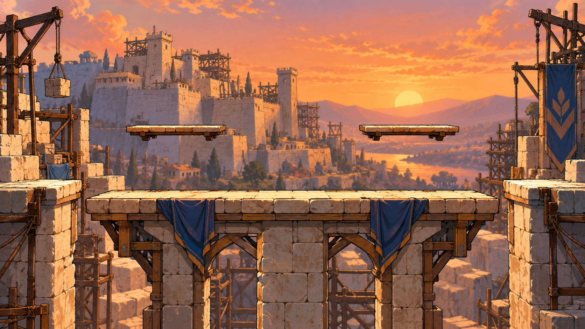

# Builders’ Court: complete arena prompt

Build this original arena from exact collision JSON and separate production art layers. Its biblical-era inspiration is **Nehemiah 4**. It is a fictional sporting platform arrangement, not a claim about historical architecture or a reenactment of a miracle.

## Visual direction

A fictional completed-wall-adjacent workers’ practice platform, limestone masonry, simple timber scaffolds in the background, blue fabric bundles, copper sunset; tools and ropes remain decorative away from collision edges. Palette: limestone / slate blue / copper. Keep backgrounds softer than fighters and platform edges. Flat side-view gameplay; use painted depth in distant scenery only. No foreground decoration obscures floor/ledge contact. The generated painting is visual direction and may approximate positions; gameplay geometry is the following contract.

## Exact geometry

Coordinates are design units, +Y up, platform Y is top; thickness extends downward. Main arena has solid top/sides/underside; upper surfaces are one-way with the global drop-through rule.

| Surface | X left | Y top | Width | Thickness | Type |
|---|---|---|---|---|---|
| Main | -540 | 0 | 1080 | 80 | Solid |
| Upper 1 | -310 | 170 | 180 | 16 | One-way |
| Upper 2 | 130 | 170 | 180 | 16 | One-way |

Blast bounds: X -1040 to 1040, Y -680 to 700. Center point crossing decides KO; camera borders do not. Spawn feet: [[-220, 82], [220, 82], [-360, 82], [360, 82]]. Pickup origins: center then symmetric left/right at Y=160. Stable IDs are supplied in maps JSON. Spawn protection and cooldowns use shared match rules.

## Gameplay intention

Two small separated platforms create controlled spacing and straightforward wall recovery. Local arena candidate, pending playtest approval. Both sides have identical colliders, recovery walls and blast distances. No random wind, damage floor, falling debris, moving ledges or breakable stage in competitive use.

## Layer production

Deliver sky, far scenery, mid scenery, platform/side-wall layer, restrained foreground and thumbnail; pivots/origins recorded. Separate collision debug overlay uses exact units, not AI-generated measurements. Parallax never moves playable surfaces. Ensure every visual upper ledge corresponds to one collision entry and vice versa; a decorative background ledge should look different.

## Camera and readability

Fit main arena and both fighters without changing fixed blast zones. Offstage warnings show player number and direction. UI/touch areas do not scale with camera. At four players, outlines and numeral markers remain readable. Reduced-motion switches off decorative motion and camera shake. Match art against both light and dark costumes before approval.

## Arena verification

Measure platform reachability with base Speed 5 then every roster Speed; aerial resources do not change by map. Test left/right recoveries from standardized launch points, under-stage recovery, dash sweeps, landing/drop-through, projectile collision, wall-fatigue enforcement and safe respawn. Save traces and compare replay hashes. Investigate camping loops, blind projectile lanes and camera zoom that makes touch play unreadable. Competitive approval needs actual results, not just symmetry.

## ELI5

This is a playground with one main floor and 2 smaller shelves above it. Jump between them and stay inside the arena. The picture makes it beautiful; the JSON tells the engine where the floor really is.
